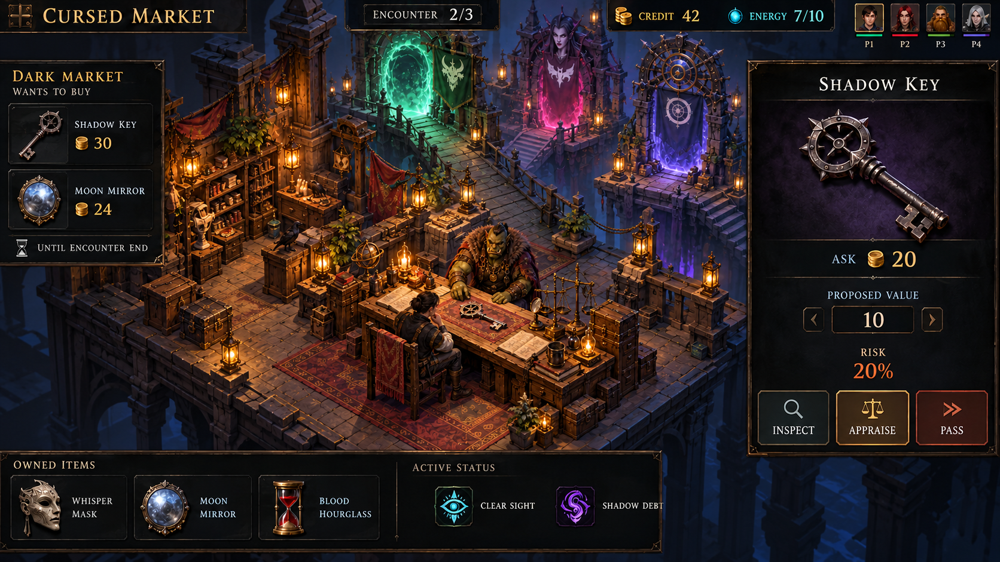
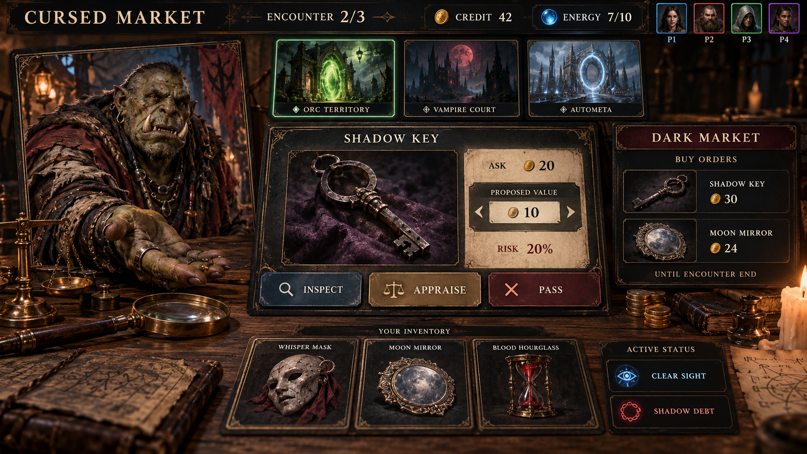
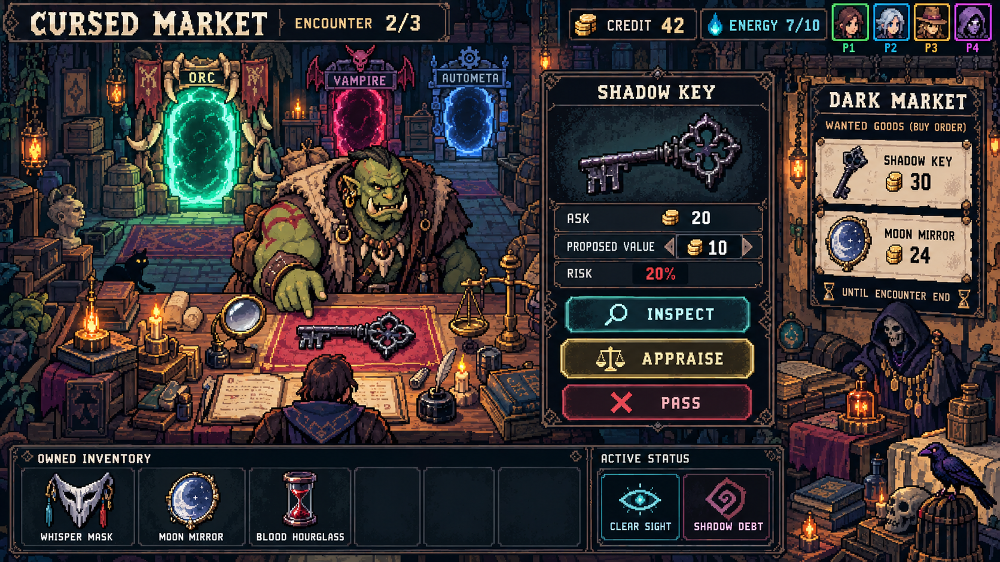

# Cursed Market — ภาพแนวทางเกม v0.4

2026-10-13 — ผู้ใช้ขอภาพตัวอย่างครบสามแนว: isometric / Three.js หรือ 2.5D, card game ที่ใช้ realistic concept art และ pixel art ภาพนี้ใช้เปรียบเทียบทิศทาง ยังไม่มีแนวที่ผู้ใช้เลือกและไม่ใช่ screenshot ของเกมที่ทำงานแล้ว

## ฉากร่วมสำหรับเปรียบเทียบ

นักประเมินพบพ่อค้าออร์กเสนอ Shadow Key ใน encounter 2/3 มีประตูต่างมิติ, inventory, credit/พลัง, สถานะผลดี/ผลเสีย และ Dark Market ที่รับซื้อจนจบ encounter ตามกติกาที่ผู้ใช้ยืนยัน ทั้งสามภาพใช้ชุดข้อมูลเดียวกันเพื่อเปรียบเทียบงานภาพและลำดับการอ่าน

ตัวเลข credit 42, energy 7/10, ราคาขอ 20, ประเมิน 10, risk 20%, รับซื้อกุญแจ 30 และกระจก 24 เป็นค่า illustrative ไม่ใช่สูตร balance ที่อนุมัติ ภาษาอังกฤษในภาพเป็นข้อความ mockup ไม่เปลี่ยนภาษาไทยของ prototype ภาพแสดงตัวอย่างช่วงที่ Dark Market เปิด ไม่เปลี่ยนกติกาการสุ่มเปิดเป็นเปิดตลอด

## 1. Isometric / 2.5D

ห้องแบบ cutaway มองเฉียงจากด้านบน เห็นโต๊ะนักประเมิน NPC ประตูและพื้นที่ห้อง แยก UI ตัดสินใจจากฉาก แนวภาพนี้เป็นเป้าหมายทางสายตาที่อาจทำเป็น 3D หรือ 2.5D ได้ แต่ไฟล์ที่ส่งเป็น PNG ไม่ใช่ scene หรือ prototype Three.js

## 2. Realistic card art

ภาพ NPC และสินค้าสมจริงอยู่ในรูปแบบการ์ดบนโต๊ะ ให้สินค้าที่กำลังประเมินและราคาตัดสินใจเป็นจุดสนใจ ประตูต่างมิติและของในมือใช้ภาพการ์ดเช่นกัน

## 3. Pixel art

ห้องนักประเมินและตัวละครเป็น pixel art พร้อมช่อง inventory และ UI แบบ pixel การออกแบบเน้นรูปร่างของสินค้า อารมณ์ NPC และบรรยากาศประตูในห้อง ไม่ได้เป็น spritesheet หรือ asset แยกชิ้นที่นำเข้าเกมได้ทันที

## ไฟล์และที่มา

ภาพสุดท้ายทั้งสามมีขนาด 1672 × 941 pixels เก็บใน directory นี้ ชื่อไฟล์ตามสามแนวข้างต้น ไม่ overwrite ภาพเดิมหรือเปลี่ยน UI ที่ใช้งานอยู่

สร้างด้วย built-in `image_gen`: generate ภาพละหนึ่งครั้ง และ edit isometric หนึ่งครั้งเพื่อยกกล้องให้เห็นห้องจากด้านบนชัดเจน ภาพรอบแรกที่ไม่ได้เลือกยังอยู่ใน default generated-images directory และไม่ถูกนับเป็น deliverable สุดท้าย

- [Prompt ชุดเริ่มต้น](generation-prompts.json)
- [Manifest ภาพสุดท้ายและ prompt ที่ใช้จริง](selected-assets.json)
- [Prompt isometric รอบแก้กล้อง](isometric-2-5d.prompt.txt)
- [Prompt realistic cards](realistic-card.prompt.txt)
- [Prompt pixel art](pixel-art.prompt.txt)

PNG แต่ละไฟล์มี generation prompt ฝังใน metadata ด้วย เป็นหลักฐานที่มาของภาพ การฝัง metadata ไม่แก้เนื้อภาพ

ตรวจภาพที่ได้ด้านฉาก สไตล์ ข้อความและข้อมูลร่วมครบ ปรับเฉพาะมุม isometric ในรอบแก้หนึ่งครั้ง ไม่มี browser/gameplay/responsive/accessibility validation จากภาพ concept นี้ ตัวเกมยังเป็น v0.3, กติกา v0.4 ยังเป็นร่าง, DESIGN.md และ sidecar ของ UI ปัจจุบันไม่เปลี่ยนเพราะยังไม่มีแนวที่ถูกเลือก
