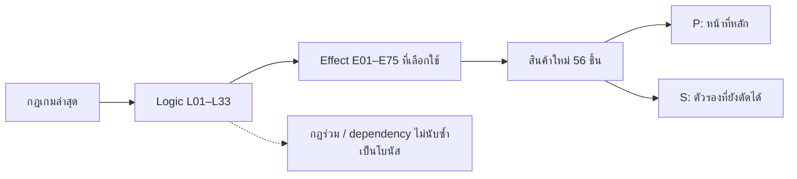

# Relation: logic ↔ สินค้าใหม่ 56 ชิ้น

อัปเดต: 2026-10-28 (Asia/Bangkok)

**ขอบเขต: แค็ตตาล็อก merchant-set-v1 ใหม่เท่านั้น — 8 พ่อค้า × 7 สินค้า** รายการสินค้าในเอกสารนี้ไม่รวมแค็ตตาล็อกเดิม

## เปิดดูและข้อมูลประกอบ

- [หน้ากราฟเส้นและตารางโต้ตอบ](logic-item-relations.html) — ตามเส้นสินค้า → effect → logic → ทรัพยากร พร้อม tooltip ค้นหา กรอง และเทียบสองสินค้า
- [วิธีอ่านสีและเส้นกราฟ](logic-item-graph-guide.md) / [Graph JSON](logic-item-graph.json) / [เส้นกราฟ CSV](logic-item-graph-edges.csv) — แยกบริบทต้นทุนระบบออกจากข้อเสียเฉพาะสินค้า
- [Matrix CSV](logic-item-matrix.csv) — 56 แถว × 33 logic เปิดในโปรแกรมตารางได้
- [Relation รายเส้น CSV](logic-item-edges.csv) — แยกหนึ่งแถวต่อการเชื่อมสำหรับ pivot/filter
- [ข้อมูล JSON](logic-item-relations.json) — snapshot ID/ชื่อจากแค็ตตาล็อกและข้อมูลที่ใช้สร้างเอกสาร
- [กฎล่าสุด](rules-and-logic.md) และ [คำอธิบาย E01–E75](effect-catalog.md)

## 1. สถานะจริงกับร่างที่ใช้ balance

แค็ตตาล็อกต้นทางระบุ `art-only` และรายการ 56 ชิ้นไม่มี effect/gameplay binding ในข้อมูลแค็ตตาล็อก ไม่พบการอ้าง ID เหล่านี้ในไฟล์ runtime .ts/.tsx/.js ของ build ที่ตรวจ ดังนั้น **การเชื่อม effect เฉพาะสินค้าใหม่ที่ตรวจยืนยันได้ขณะนี้ = 0** การโหลดภาพหรือการที่ของชิ้นหนึ่งถูกซื้อขายได้ ไม่ได้พิสูจน์ว่ามี effect เฉพาะของนั้นแล้ว

ตารางถัดไปเป็น **ร่างการเชื่อมเพื่อให้เห็น coverage และวิจารณ์ balance** ไม่ใช่รายงานว่าสินค้าเหล่านี้ทำงานตามนี้แล้ว แต่ละชิ้นมีหน้าที่หลักหนึ่งอย่างและตัวรองที่ยังเลือกตัดได้ การมีตัวรองในเอกสารไม่ได้อนุมัติให้ใส่ทั้งหมด

| ตัวชี้วัด | จำนวน / ความหมาย |
|---|---|
| สินค้า / พ่อค้า | 56 / 8 |
| Logic ที่แสดง | 33 รวมโครงสร้างร่วม 2 ระบบ |
| เส้นหลัก P | 56 |
| เส้นตัวรอง S | 57 |
| สินค้าที่แตะมากกว่า 2 ระบบเมื่อรวมตัวรอง | 3 |
| กลุ่มสินค้าที่ใช้ชุด effect ซ้ำกันทั้งหมด | 1 |
| Logic เกมที่ยังไม่มี effect สินค้าเชื่อมตรงในร่าง | 3 |
| Dedicated runtime binding ของ 56 ชิ้นที่ยืนยันได้ | 0 |

## 2. วิธีนับ relation

- **P — Primary:** หน้าที่หลักหนึ่งอย่างที่เสนอให้สินค้า
- **S — Optional secondary:** ตัวรองที่เสนอให้พิจารณา อาจตัดออกหรือให้เลือกใช้แทน P; ยังไม่กำหนดว่าจะเป็น passive หรือ active คู่กัน
- **I — Indirect:** กระทบผ่านระบบอื่น ไม่บวกจำนวน direct benefit
- จำนวนระบบนับ logic ID ไม่ซ้ำ ไม่ใช่จำนวนข้อความ effect หากมีสอง effect ในระบบเดียวกันยังนับเป็นหนึ่งระบบ แต่ตรวจความเสี่ยงของคู่ effect เพิ่มต่างหาก
- แถวที่มากกว่า 2 ระบบเป็นธงตรวจความกว้าง ตัวเลขนี้ไม่ใช่คะแนนพลังหรือข้อพิสูจน์ว่าสินค้าโกง
- ไม่นับข้อเท็จจริงร่วมว่าทุกสินค้าใช้เงินซื้อ มี rarity มีมูลค่าตอนจบ โอนเจ้าของได้ หรือมี log เป็นโบนัสพิเศษของทุกชิ้น มิฉะนั้น relation จะดูแน่นโดยไม่บอกหน้าที่จริง

## 3. ช่องว่างและจุดหนาแน่นที่พบในร่าง

### ช่องว่างที่ต้องเห็นชัด

- **L21 Collector Wishlist:** ยังไม่มีสินค้าเชื่อม effect เฉพาะรอบ 3+2 ของ Collector; E55–E57 อยู่ที่สัญญารับซื้อ NPC การนับสองระบบนี้รวมกันจะซ่อนช่องว่างนี้
- **L30 คะแนนพิเศษผู้นำ:** ยังไม่มี item modifier ที่อนุมัติ สินค้าถูกนับในสถิติได้ตามกฎ แต่ห้ามเติมตัวนับหรือคูณรางวัลเอง; วิธีเสมอ/คะแนนบางหมวดยังไม่ตกลง
- **L31 สำเนา:** ยังไม่มีสินค้าเฉพาะทางที่ปรับสำเนาโดยตรง กลุ่มไข่รังแตะผ่านสกิล Swarm แบบ I เท่านั้น ต้องพิจารณาว่าต้องมีสินค้าเฉพาะทางจริงหรือใช้ความสามารถพ่อค้าพอ
- **L32 Log และ L33 เจ้าของ/คลัง/หลักประกัน:** ไม่มี modifier เฉพาะสินค้าโดยตั้งใจ เป็นข้อบังคับร่วม ไม่ใช่ feature ที่ควรแก้ด้วยการเพิ่มโบนัสสินค้า

### สินค้าที่กว้างเกินเกณฑ์ตรวจเมื่อรวมตัวรอง

| สินค้า | ระบบตรง | จุดเสนอให้ลด |
|---|---|---|
| ปริซึมบันทึกข้อมูล | L01, L02, L08 | ข้อมูลราคา+ความแท้+ประมูลครอบคลุมกว้าง พิจารณาตัดตัวรองหนึ่งอย่าง |
| แผนที่ดาวเยื่อชีวภาพ | L09, L11, L12 | rarity+ข้อมูลเส้นทาง+ตัวเลือกสกิล ครอบคลุมสามระบบ ควรเลือกตัวรองเพียงหนึ่ง |
| กรงปลาโคม | L01, L08, L12 | ข้อมูลเส้นทาง+ราคา+ประมูลสามระบบ พิจารณาลดให้เป็นของสืบประตูเฉพาะทาง |

### ชุด effect ซ้ำทั้งหมด

| สินค้า | Effect ร่วม | สิ่งที่ต้องตัดสิน |
|---|---|---|
| กลองศึกกระดูก, อานสาหร่าย | E16, E64 | ใช้ trigger/ต้นทุน/เป้าหมายต่างกันจริง หรือเลือกเก็บชุดนี้เพียงหนึ่งสินค้า |

### ความเสี่ยงที่จำนวนเส้นอย่างเดียวมองไม่เห็น

1. **แหวนตราราตรี:** E46 ดอกเบี้ย + E50 โบนัสผู้ให้กู้ อาจเร่งฐานทุนหลายทาง เงินใหม่ยังต้องรออายุฝากครบเสมอ
2. **เครื่องยิงขดลวด:** E05 เพิ่มโอกาสท้าทายสำเร็จ + E06 ลดโทษพลาด อยู่เพียง L02 ระบบเดียว แต่ลดความเสี่ยงทั้งสองด้าน
3. **คัมภีร์สุญญะ:** E69 คะแนนฐาน + E72 ยืดสถานะ ต้องห้ามวงจรยืด buff คะแนนที่ทำให้ตัวเองทวีคูณ
4. **กลองศึกกระดูก / อานสาหร่าย:** ซื้อขายคืนพลังพร้อมให้เศษเพิ่ม อาจหมุน action กับคู่ค้าเดิม ต้องใช้ข้อจำกัด anti-farming จริง
5. **หน้าปัดระยะเฟส / สารหล่อเย็น:** การเร่งคูลดาวน์และประหยัด/ฟื้นพลังอาจเพิ่มจำนวนการใช้สกิลมากกว่าที่ตัวเลขราคาบอก
6. **บ่วงเส้นเขี้ยว + สินค้า E38/E40:** ลดต้นทุนขโมย เพิ่ม edge และลดผลแพ้เป็น synergy ข้ามชิ้น ต้องตรวจทั้งชุด ไม่ดูชิ้นเดียว
7. **ปริซึม / คาลิเปอร์ / กรงปลาโคม / แผนที่ดาว:** เปรียบเทียบต้นทุนกับข้อมูลที่เปิดได้จริง เพื่อไม่ให้ชิ้นเดียวแทนเครื่องมืออื่นทั้งหมด

## 4. Logic → สินค้าที่เสนอให้รองรับ

จำนวน P และ S อาจมีสินค้าชิ้นเดียวอยู่ทั้งสองช่อง; รวมตรงนับชื่อไม่ซ้ำ ตัวเลือก S ยังไม่ใช่การผูกที่อนุมัติ

| Logic | สถานะระบบ | P หลัก | S ตัวรอง | รวมตรง | สินค้าหลัก | สินค้าตัวรอง / dependency |
|---|---|---:|---:|---:|---|---|
| L01 ตรวจและประเมินราคา | มีระบบ | 2 | 1 | 3 | ปริซึมบันทึกข้อมูล, คาลิเปอร์วัดแรงบิด | กรงปลาโคม |
| L02 ความแท้และท้าทาย | มีระบบ | 2 | 4 | 5 | เครื่องพ่นละอองหมอก, เครื่องยิงขดลวด | เครื่องยิงขดลวด, ปริซึมบันทึกข้อมูล, คาลิเปอร์วัดแรงบิด, ตรีศูลห้วงลึก |
| L03 คำสาปและการชำระ | มีระบบ | 2 | 1 | 3 | คีมตีเหล็กเผ่า, ตรีศูลห้วงลึก | ที่ครอบดับเสียง |
| L04 ซื้อและต่อรอง NPC | มีระบบ | 3 | 0 | 3 | ไวโอลินสนธยา, เครื่องแปลความคิด, เครื่องพ่นฟีโรโมน | — |
| L05 ขาย/ค่านายหน้า/ระบาย | มีระบบ | 1 | 2 | 3 | ลูกปัดนับชัย | คีมตีเหล็กเผ่า, ค้อนรัง |
| L06 ซื้อขายระหว่างผู้เล่น | มีระบบ | 2 | 4 | 6 | กลองศึกกระดูก, อานสาหร่าย | ผ้าคลุมเสียงสะท้อน, เครื่องแปลความคิด, ตราประทับเถ้าถ่าน, เครื่องพ่นฟีโรโมน |
| L07 ตลาดมืดและของค้าง | มีระบบ | 0 | 2 | 2 | — | เครื่องพ่นละอองหมอก, อานข้ามรอยแยก |
| L08 ประมูล | มีระบบ | 1 | 4 | 5 | บัตรเชิญเที่ยงคืน | ลูกปัดนับชัย, ปริซึมบันทึกข้อมูล, สัญญาณไฟพับได้, กรงปลาโคม |
| L09 Rarity | มีระบบแบบมี config | 2 | 0 | 2 | แผนที่ดาวเยื่อชีวภาพ, แผ่นกลิ่นสะกดรอย | — |
| L10 ความไว้ใจและสต็อก | มีระบบ | 1 | 3 | 4 | ดาบสาบานเผ่า | ไวโอลินสนธยา, เขาส่งสัญญาณ, ดาบเขี้ยวรอยแยก |
| L11 ความสามารถพ่อค้า | มีระบบ | 4 | 1 | 5 | กระป๋องสารหล่อเย็น, หน้าปัดระยะเฟส, กลุ่มไข่รัง, เขาส่งสัญญาณ | แผนที่ดาวเยื่อชีวภาพ |
| L12 ประตูและเส้นทาง | มีระบบ | 5 | 5 | 10 | สัญญาณไฟพับได้, เข็มทิศกระแสน้ำ, กรงปลาโคม, เครื่องร่อนเยื่อปีก, อานข้ามรอยแยก | ตะเกียงสปอร์, แผนที่ดาวเยื่อชีวภาพ, หน้าปัดระยะเฟส, เหรียญผ่านแดน, แผ่นกลิ่นสะกดรอย |
| L13 ขโมยเชิงรุก RPS | มี RPS; กฎห้ามปฏิเสธยังมีช่องว่าง | 3 | 2 | 5 | ดาบจันทร์แหว่ง, บ่วงเส้นเขี้ยว, ดาบเขี้ยวรอยแยก | ดาบสาบานเผ่า, เครื่องร่อนเยื่อปีก |
| L14 บรรเทาผลถูกขโมย | effect ยังเป็นข้อเสนอ | 2 | 4 | 6 | เสื้อคลุมหมอก, ยามกลไกไขลาน | โล่เขี้ยวออร์ก, ดาบสุญญะ, ทุ่นแก้วคลื่น, กับดักกรามดีด |
| L15 อาชญากรรมและค่าชดเชย | มีระบบ | 1 | 4 | 5 | เหรียญผ่านแดน | เสื้อคลุมหมอก, โซ่พันธะหนี้, หลอดม้วนยางไม้, บ่วงเส้นเขี้ยว |
| L16 ดอกเบี้ยเงินฝาก | กฎใหม่ 10%; โค้ด snapshot เดิมยัง 4% | 2 | 0 | 2 | แหวนตราราตรี, ทุ่นแก้วคลื่น | — |
| L17 พื้นที่และการขยาย Vault | มีระบบ | 1 | 1 | 2 | ค้อนรัง | สายรัดเซอร์โว |
| L18 เงินกู้มีหลักประกัน | มีระบบ | 1 | 1 | 2 | โซ่พันธะหนี้ | แหวนตราราตรี |
| L19 ตราบาป | มีระบบ | 3 | 0 | 3 | ตราประทับเถ้าถ่าน, หลอดม้วนยางไม้, กับดักกรามดีด | — |
| L20 สัญญารับซื้อ Wishlist NPC | มีระบบ | 1 | 3 | 4 | คทาเคลื่อนเฟส | บัตรเชิญเที่ยงคืน, เข็มทิศกระแสน้ำ, แตรสังข์วาฬ |
| L21 Collector Wishlist 3+2 | กฎใหม่; ยังไม่มีการเชื่อมสินค้า | 0 | 0 | 0 | — | — |
| L22 สัญญาส่วนตัว NPC | มีระบบ | 2 | 1 | 3 | ขวดรินไวน์เงา, แท่นรองดักแด้ | คทาเคลื่อนเฟส |
| L23 พลัง | มีระบบ | 3 | 1 | 4 | สนับแข้งรากเหล็ก, สายรัดเซอร์โว, ฝักเมล็ดเรืองแสง | กระป๋องสารหล่อเย็น |
| L24 ชีวิตและการฟื้นฟู | มีระบบ | 5 | 2 | 7 | โล่เขี้ยวออร์ก, ยาทาเถ้าร้อน, เกราะแรงดันใต้ทะเล, แตรสังข์วาฬ, เกราะไคติน | ขวดรินไวน์เงา, เสื้อคลุมขนอำพัน |
| L25 เศษชีพจรและคู่ค้า | มีระบบ | 0 | 4 | 4 | — | กลองศึกกระดูก, ฝักเมล็ดเรืองแสง, อานสาหร่าย, แท่นรองดักแด้ |
| L26 ภัย Dread/ผุพัง | มีระบบแบบมี config | 3 | 3 | 6 | ตะเกียงสปอร์, กระถางกำยานลางร้าย, เสื้อคลุมขนอำพัน | ยามกลไกไขลาน, เกราะแรงดันใต้ทะเล, เกราะไคติน |
| L27 สถานะผลดี/ผลเสีย | มีระบบ | 3 | 3 | 6 | ผ้าคลุมเสียงสะท้อน, ดาบสุญญะ, ที่ครอบดับเสียง | ยาทาเถ้าร้อน, คัมภีร์สุญญะ, กระถางกำยานลางร้าย |
| L28 รางวัลและทายเหรียญ | มีระบบ | 0 | 1 | 1 | — | ดาบจันทร์แหว่ง |
| L29 Collector และคะแนนฐาน | มีสูตรฐาน | 1 | 0 | 1 | คัมภีร์สุญญะ | — |
| L30 คะแนนพิเศษผู้นำ | กฎใหม่; วิธีนับบางส่วนยังไม่ตกลง | 0 | 0 | 0 | — | — |
| L31 สำเนาสินค้า | มีระบบผ่าน Swarm | 0 | 0 | 0 | — | —; I: กลุ่มไข่รัง |
| L32 Log/ข้อมูลปกปิด | มี trace/ledger; ไม่ได้ audit ครบทุกเหตุการณ์ | 0 | 0 | 0 | — | — |
| L33 เจ้าของ/คลัง/หลักประกัน | มีระบบ | 0 | 0 | 0 | — | — |

## 5. สินค้า → Logic และหน้าที่ที่เสนอ

แต่ละแถวคือ **ร่าง** จากชื่อ/รูปแบบสินค้าชุดใหม่ ไม่ใช่ logic ที่ดึงออกจากภาพ และไม่ได้รับรองว่าสินค้าควรได้ทุก effect ในแถวพร้อมกัน

### ออร์ก

| สินค้า / ID | P หน้าที่หลัก | S ตัวรองที่ยังเลือกตัดได้ | จำนวนระบบตรง | ข้อควรทบทวน |
|---|---|---|---:|---|
| ดาบสาบานเผ่า `orc-oath-sword` | E28 / L10: พบพ่อค้ารายใหม่แล้วได้ความไว้ใจเพิ่ม | E38 / L13: ได้เปรียบเมื่อเป่ายิ้งฉุบเสมอหนึ่งครั้ง | 2 | ความไว้ใจกับความได้เปรียบ RPS ต้องแยก trigger; ดาบเป็นภาพสินค้า ไม่เพิ่มระบบต่อสู้ใหม่ |
| โล่เขี้ยวออร์ก `orc-tusk-shield` | E62 / L24: ลดความเสียหายชีวิตครั้งถัดไป | E40 / L14: บรรเทาผลเสียเมื่อแพ้ดวลหนึ่งครั้ง | 2 | บรรเทาผลหลังดวลเท่านั้น ห้ามกันไม่ให้เริ่ม RPS |
| สนับแข้งรากเหล็ก `orc-ironroot-greaves` | E61 / L23: ฟื้นพลังเมื่อเริ่มช่วง | — | 1 | ผู้เล่นที่ไม่ขาดพลังอาจไม่ต้องการ ต้องทดสอบมูลค่าเทียบของฟื้นพลังอื่น |
| ยาทาเถ้าร้อน `orc-ember-salve` | E63 / L24: ลดราคาดีลฟื้นพลังหรือชีวิต | E71 / L27: ลบผลเสียที่เลือกหนึ่งอย่าง | 2 | ของใช้แล้วหมด; ลดค่าดีลชีวิตและลบสถานะต้องเลือกว่าจะให้ครบทั้งสองหรือไม่ |
| กลองศึกกระดูก `orc-bone-war-drum` | E16 / L06: ซื้อขายกับคู่ค้ารายใหม่แล้วคืนพลัง | E64 / L25: ได้เศษเพิ่มเมื่อเปลี่ยนคู่ค้าตามเกณฑ์ | 2 | คืนพลังพร้อมเพิ่มเศษอาจซื้อขายวนได้ ต้องรักษากฎคู่ค้าใหม่ |
| ลูกปัดนับชัย `orc-tally-beads` | E13 / L05: เพิ่มค่านายหน้า | E24 / L08: ชนะต่ำกว่าราคาประเมินที่รู้แล้วได้โบนัส | 2 | รายได้ค่านายหน้ากับโบนัสประมูลต้องมีงบและเพดานแยก |
| คีมตีเหล็กเผ่า `orc-clan-forge-tongs` | E07 / L03: เพิ่มโอกาสชำระสำเร็จ | E14 / L05: เพิ่มเงินจากการขายระบาย | 2 | ชำระแล้วขายระบายสร้างเส้นทำกำไร ต้องหักต้นทุนเครื่องมือจริง |

### แวมไพร์

| สินค้า / ID | P หน้าที่หลัก | S ตัวรองที่ยังเลือกตัดได้ | จำนวนระบบตรง | ข้อควรทบทวน |
|---|---|---|---:|---|
| เสื้อคลุมหมอก `vampire-mist-cloak` | E42 / L14: รับเงินประกันบางส่วนเมื่อของถูกขโมยจริง | E43 / L15: ลดค่าล้างประวัติ | 2 | ประกันหลังเสียของ ไม่ปฏิเสธดวล; ลดค่าล้างประวัติต้องไม่ทำการขโมยไร้ความเสี่ยง |
| แหวนตราราตรี `vampire-nocturne-signet` | E46 / L16: เพิ่มดอกเบี้ยของเงินต้นที่ครบช่วง | E50 / L18: ผู้ให้กู้รับโบนัสเมื่อสัญญาจบครบถ้วน | 2 | ดอกเบี้ย+ผลตอบแทนให้กู้อาจเร่งทุนสองทาง; เงินใหม่ไม่มีอายุฝากย้อนหลัง |
| ขวดรินไวน์เงา `vampire-shadow-wine-decanter` | E58 / L22: ลดค่าชีวิตสัญญาเลือด Vampire | E63 / L24: ลดราคาดีลฟื้นพลังหรือชีวิต | 2 | ลดค่าชีวิตสัญญาและดีลรักษาอาจทำสัญญาเลือดแทบฟรี |
| ไวโอลินสนธยา `vampire-gloam-violin` | E11 / L04: เพิ่มโอกาสพ่อค้ายอมรับราคา | E29 / L10: ป้องกันความไว้ใจลดหนึ่งครั้ง | 2 | เพิ่มการยอมรับพร้อมกันความไว้ใจลด อาจลดความเสี่ยงต่อรองมากไป |
| เครื่องพ่นละอองหมอก `vampire-mist-atomizer` | E06 / L02: ลดโทษจากการท้าทายพลาด | E20 / L07: ลดความเสียหายจากการจัดการของค้าง | 2 | ลดโทษสองระบบ อาจกลายเป็นของกลางที่ทุกสายต้องถือ |
| บัตรเชิญเที่ยงคืน `vampire-midnight-invitation` | E22 / L08: ชนะแล้วได้เงินคืนบางส่วน | E55 / L20: เพิ่มรางวัลส่งของสำเร็จ | 2 | โบนัสประมูลและสัญญารับซื้อ NPC ต้องไม่อ้างว่าเพิ่มสิทธิ์ Collector Wishlist |
| ดาบจันทร์แหว่ง `vampire-mooncut-sword` | E38 / L13: ได้เปรียบเมื่อเป่ายิ้งฉุบเสมอหนึ่งครั้ง | E75 / L28: คืนเงินที่เสียบางส่วนหนึ่งครั้ง | 2 | RPS กับทายเหรียญเป็นคนละการเสี่ยง จำกัดประกันและ tie advantage แยกกัน |

### ออโตเมตา

| สินค้า / ID | P หน้าที่หลัก | S ตัวรองที่ยังเลือกตัดได้ | จำนวนระบบตรง | ข้อควรทบทวน |
|---|---|---|---:|---|
| เครื่องยิงขดลวด `autometa-coil-repeater` | E05 / L02: เพิ่มโอกาสท้าทายคำระบุสำเร็จ | E06 / L02: ลดโทษจากการท้าทายพลาด | 1 | สอง effect อยู่ระบบเดียว แต่เพิ่มชนะและลดโทษพร้อมกันอาจท้าทายแบบไม่เสี่ยง |
| ยามกลไกไขลาน `autometa-clockwork-sentry` | E40 / L14: บรรเทาผลเสียเมื่อแพ้ดวลหนึ่งครั้ง | E68 / L26: คุ้มครองของจากการผุพังหนึ่งครั้ง | 2 | กันผุพังไม่ใช่กันดวล; กำหนดชาร์จคุ้มครองแยกชัด |
| ปริซึมบันทึกข้อมูล `autometa-data-prism` | E02 / L01: เปิดเผยช่วงราคาที่แคบลง | E04 / L02: ตรวจความแท้ฟรีหนึ่งครั้ง; E23 / L08: ตรวจข้อมูลหนึ่งอย่างของล็อตประมูล | 3 | ข้อมูลราคา+ความแท้+ประมูลครอบคลุมกว้าง พิจารณาตัดตัวรองหนึ่งอย่าง |
| กระป๋องสารหล่อเย็น `autometa-coolant-canister` | E31 / L11: ลดเวลารอของความสามารถที่เลือก | E61 / L23: ฟื้นพลังเมื่อเริ่มช่วง | 2 | ลดคูลดาวน์และเติมพลังอาจวนเร่งสกิล ต้องมีต้นทุน/จำนวนครั้ง |
| คาลิเปอร์วัดแรงบิด `autometa-torque-caliper` | E01 / L01: ตรวจราคาโดยประหยัดพลัง | E05 / L02: เพิ่มโอกาสท้าทายคำระบุสำเร็จ | 2 | ตรวจราคาประหยัดกับท้าทายต้องไม่ใช้สิทธิ์ฟรีซ้ำ; ใกล้บทบาทปริซึม |
| สัญญาณไฟพับได้ `autometa-folding-beacon` | E35 / L12: ดูเบาะแสสินค้าเพิ่มก่อนเลือกประตู | E23 / L08: ตรวจข้อมูลหนึ่งอย่างของล็อตประมูล | 2 | เบาะแสประตูกับตรวจล็อตประมูลอาจกว้างเกินภาพอุปกรณ์ส่งสัญญาณ |
| สายรัดเซอร์โว `autometa-servo-harness` | E61 / L23: ฟื้นพลังเมื่อเริ่มช่วง | E47 / L17: ลดราคาขยายคลัง | 2 | บทบาทพลังและส่วนลดช่องคลังต้องมีราคาเหมาะ ไม่เพิ่มช่องฟรีโดยไม่ได้ตกลง |

### เอเลียน

| สินค้า / ID | P หน้าที่หลัก | S ตัวรองที่ยังเลือกตัดได้ | จำนวนระบบตรง | ข้อควรทบทวน |
|---|---|---|---:|---|
| ตะเกียงสปอร์ `alien-spore-lantern` | E67 / L26: ลดโอกาสภัย Dread | E35 / L12: ดูเบาะแสสินค้าเพิ่มก่อนเลือกประตู | 2 | ลดภัยกับรู้เบาะแสอาจทำการเลือกเส้นทางปลอดภัยเกินไป |
| ผ้าคลุมเสียงสะท้อน `alien-echoweave-shawl` | E72 / L27: ยืดผลดีที่เลือกหนึ่งอย่าง | E16 / L06: ซื้อขายกับคู่ค้ารายใหม่แล้วคืนพลัง | 2 | ยืดสถานะต้องไม่ยืดสิทธิ์เปิดดู Collector หรือสัญญา; ระวังคืนพลังจากการค้า |
| แผนที่ดาวเยื่อชีวภาพ `alien-star-chart-membrane` | E25 / L09: เพิ่มโอกาสสร้างสินค้าระดับสูง | E35 / L12: ดูเบาะแสสินค้าเพิ่มก่อนเลือกประตู; E32 / L11: เพิ่มตัวเลือกเมื่อใช้ความสามารถเลือกสินค้า | 3 | rarity+ข้อมูลเส้นทาง+ตัวเลือกสกิล ครอบคลุมสามระบบ ควรเลือกตัวรองเพียงหนึ่ง |
| ฝักเมล็ดเรืองแสง `alien-biobright-seedpod` | E61 / L23: ฟื้นพลังเมื่อเริ่มช่วง | E65 / L25: ลดเศษที่ต้องใช้ฟื้นชีวิต | 2 | ฟื้นพลังและใช้เศษรักษาถูกลงอาจแทนที่ของทรัพยากรเฉพาะทาง |
| เครื่องแปลความคิด `alien-thought-translator` | E11 / L04: เพิ่มโอกาสพ่อค้ายอมรับราคา | E17 / L06: แลกสินค้าสำเร็จแล้วได้โบนัส | 2 | NPC ยอมรับราคากับโบนัสแลก PvP ต้องไม่บังคับผู้เล่นคนอื่นรับการค้า |
| หน้าปัดระยะเฟส `alien-phase-dial` | E31 / L11: ลดเวลารอของความสามารถที่เลือก | E34 / L12: ลดพลังเปลี่ยนประตู | 2 | คูลดาวน์สกิลกับประหยัดเปลี่ยนประตูมีผลต่อจำนวน action มากกว่าตัวเลขราคา |
| คทาเคลื่อนเฟส `alien-phase-staff` | E57 / L20: เปลี่ยนสัญญาที่ไม่ต้องการฟรีหนึ่งครั้ง | E60 / L22: ลดเวลารอคืนของจาก Alien | 2 | เปลี่ยนสัญญา NPC และเร่งคืนของ Alien ไม่เปลี่ยนรอบส่ง Collector |

### ดาร์กวัน

| สินค้า / ID | P หน้าที่หลัก | S ตัวรองที่ยังเลือกตัดได้ | จำนวนระบบตรง | ข้อควรทบทวน |
|---|---|---|---:|---|
| ดาบสุญญะ `darkone-null-sword` | E71 / L27: ลบผลเสียที่เลือกหนึ่งอย่าง | E40 / L14: บรรเทาผลเสียเมื่อแพ้ดวลหนึ่งครั้ง | 2 | ลบ debuff ไม่ลบหนี้/ประวัติหรือยกเลิกดวล; แยกคำสาปติดสินค้าจากสถานะผู้เล่น |
| คัมภีร์สุญญะ `darkone-null-testament` | E69 / L29: เพิ่มตัวปรับมูลค่าที่ Collector คิด | E72 / L27: ยืดผลดีที่เลือกหนึ่งอย่าง | 2 | คะแนนฐานกับยืด buff คะแนนอาจทวีคูณกัน ต้องห้ามยืดผลของตัวเองเป็นวงจร |
| โซ่พันธะหนี้ `darkone-debt-chain` | E49 / L18: ผู้กู้คืนครบแล้วรับเงินคืนบางส่วน | E44 / L15: ช่วยจ่ายค่าชดเชยบางส่วน | 2 | คืนเงินกู้แล้วได้เงินคืนและช่วยจ่ายชดเชยต้องมีแหล่งเงิน ไม่หักสิทธิ์ผู้รับ |
| กระถางกำยานลางร้าย `darkone-omen-censer` | E67 / L26: ลดโอกาสภัย Dread | E70 / L27: ลดระยะเวลาผลเสียถัดไป | 2 | ลดภัยพร้อมลดระยะ debuff อาจปิดความเสี่ยงหลายแหล่ง |
| ตราประทับเถ้าถ่าน `darkone-ash-seal` | E53 / L19: ใช้ตรายึดของแล้วตรวจข้อมูลของนั้นฟรี | E18 / L06: ส่งต่อสินค้าที่ตรวจแล้วได้รับค่ารับรอง | 2 | ตรวจของหลังยึดสำเร็จเท่านั้น; รูปตราบนสินค้าไม่ใช่ตราบาปที่ใช้ยึดโดยตัวมันเอง |
| เหรียญผ่านแดน `darkone-crossing-token` | E43 / L15: ลดค่าล้างประวัติ | E34 / L12: ลดพลังเปลี่ยนประตู | 2 | ลดค่าล้างประวัติไม่ทำให้หนี RPS หรือกลับมาเริ่มขโมยซ้ำผิดคูลดาวน์ |
| ที่ครอบดับเสียง `darkone-silence-snuffer` | E71 / L27: ลบผลเสียที่เลือกหนึ่งอย่าง | E09 / L03: ชำระพลาดแล้วรักษาอุปกรณ์ไว้หนึ่งครั้ง | 2 | ลบสถานะกับรักษาเครื่องมือชำระเป็นคนละเหตุการณ์ ห้ามลบภาระสัญญา |

### ชาวทะเลลึก

| สินค้า / ID | P หน้าที่หลัก | S ตัวรองที่ยังเลือกตัดได้ | จำนวนระบบตรง | ข้อควรทบทวน |
|---|---|---|---:|---|
| ตรีศูลห้วงลึก `deepsea-abyss-trident` | E07 / L03: เพิ่มโอกาสชำระสำเร็จ | E05 / L02: เพิ่มโอกาสท้าทายคำระบุสำเร็จ | 2 | ชำระกับท้าทายต้องเลือกบทบาทหลักให้ต่างจากคีมออร์ก |
| เกราะแรงดันใต้ทะเล `deepsea-pressure-cuirass` | E62 / L24: ลดความเสียหายชีวิตครั้งถัดไป | E67 / L26: ลดโอกาสภัย Dread | 2 | ลดทั้งโอกาสภัยและความเสียหายอาจแรงแบบคูณกัน |
| เข็มทิศกระแสน้ำ `deepsea-tide-compass` | E34 / L12: ลดพลังเปลี่ยนประตู | E57 / L20: เปลี่ยนสัญญาที่ไม่ต้องการฟรีหนึ่งครั้ง | 2 | หาเส้นทาง/เปลี่ยนสัญญา NPC ไม่เพิ่มสิทธิ์สุ่ม Collector ใหม่ |
| อานสาหร่าย `deepsea-kelp-saddle` | E16 / L06: ซื้อขายกับคู่ค้ารายใหม่แล้วคืนพลัง | E64 / L25: ได้เศษเพิ่มเมื่อเปลี่ยนคู่ค้าตามเกณฑ์ | 2 | คู่ effect ตรงกับกลองศึกกระดูก ต้องเลือกความต่างหรือเก็บเพียงหนึ่งบทบาท |
| ทุ่นแก้วคลื่น `deepsea-tideglass-buoy` | E46 / L16: เพิ่มดอกเบี้ยของเงินต้นที่ครบช่วง | E42 / L14: รับเงินประกันบางส่วนเมื่อของถูกขโมยจริง | 2 | ดอกเบี้ยและประกันขโมยทำให้สะสมทุนปลอดภัย ต้องจำกัดผลตอบแทนรวม |
| กรงปลาโคม `deepsea-lanternfish-cage` | E35 / L12: ดูเบาะแสสินค้าเพิ่มก่อนเลือกประตู | E02 / L01: เปิดเผยช่วงราคาที่แคบลง; E23 / L08: ตรวจข้อมูลหนึ่งอย่างของล็อตประมูล | 3 | ข้อมูลเส้นทาง+ราคา+ประมูลสามระบบ พิจารณาลดให้เป็นของสืบประตูเฉพาะทาง |
| แตรสังข์วาฬ `deepsea-whale-conch-horn` | E63 / L24: ลดราคาดีลฟื้นพลังหรือชีวิต | E55 / L20: เพิ่มรางวัลส่งของสำเร็จ | 2 | ดีลรักษาและโบนัสสัญญารับซื้อ NPC ควรไม่เป็นของหาเงินและรักษาครบในชิ้นเดียว |

### สวอร์ม

| สินค้า / ID | P หน้าที่หลัก | S ตัวรองที่ยังเลือกตัดได้ | จำนวนระบบตรง | ข้อควรทบทวน |
|---|---|---|---:|---|
| ค้อนรัง `swarm-brood-hammer` | E47 / L17: ลดราคาขยายคลัง | E14 / L05: เพิ่มเงินจากการขายระบาย | 2 | ส่วนลดช่องคลังและราคาขายระบายควรมีจังหวะใช้ต่างกัน |
| เครื่องพ่นฟีโรโมน `swarm-pheromone-sprayer` | E11 / L04: เพิ่มโอกาสพ่อค้ายอมรับราคา | E16 / L06: ซื้อขายกับคู่ค้ารายใหม่แล้วคืนพลัง | 2 | ส่วนลดความเสี่ยงต่อรองกับคืนพลัง PvP ทำให้ใช้งานได้แทบทุกสายค้า |
| กลุ่มไข่รัง `swarm-hive-egg-cluster` | E33 / L11: เสริมการใช้หนึ่งครั้งตามระดับที่ปลดล็อกแล้ว | —; I: L31 ผ่านการเสริมสกิล Swarm | 1 | จำกัดเสริมสกิล Swarm ที่ปลดล็อกแล้ว; เป็น dependency ต่อการสร้างสำเนา ไม่ใช่สร้างสำเนาฟรีแยกสกิล |
| หลอดม้วนยางไม้ `swarm-resin-spool` | E52 / L19: แลกเปลี่ยนตราสำเร็จแล้วฟื้นพลัง | E44 / L15: ช่วยจ่ายค่าชดเชยบางส่วน | 2 | ตราบาปเป็นการค้าระหว่างผู้เล่น ต้องกันส่งกลับไปมาเพื่อฟื้นพลัง |
| เครื่องร่อนเยื่อปีก `swarm-wing-membrane-glider` | E34 / L12: ลดพลังเปลี่ยนประตู | E37 / L13: ลดพลังเริ่มขโมย | 2 | ประหยัดพลังสอง action ต้องไม่ลดจนต้นทุนเสี่ยงแทบเป็นศูนย์ |
| แท่นรองดักแด้ `swarm-pupa-cradle` | E59 / L22: เพิ่มผลตอบแทนของที่ให้ Alien ยืม | E65 / L25: ลดเศษที่ต้องใช้ฟื้นชีวิต | 2 | ผลตอบแทนสัญญา Alien กับเศษรักษาเป็นคนละวงจร ใช้ชาร์จ/ช่วงแยก |
| เกราะไคติน `swarm-chitin-cuirass` | E62 / L24: ลดความเสียหายชีวิตครั้งถัดไป | E68 / L26: คุ้มครองของจากการผุพังหนึ่งครั้ง | 2 | เทียบกับโล่ออร์ก/เกราะทะเล ต้องมีความต่างที่วัดได้มากกว่าชื่อ |

### บีสต์

| สินค้า / ID | P หน้าที่หลัก | S ตัวรองที่ยังเลือกตัดได้ | จำนวนระบบตรง | ข้อควรทบทวน |
|---|---|---|---:|---|
| แผ่นกลิ่นสะกดรอย `beast-trail-scent-disc` | E25 / L09: เพิ่มโอกาสสร้างสินค้าระดับสูง | E35 / L12: ดูเบาะแสสินค้าเพิ่มก่อนเลือกประตู | 2 | คล้ายแผนที่ดาวแบบสองระบบ ควรเป็น baseline ที่ราคาถูกหรือเงื่อนไขง่ายกว่า |
| เขาส่งสัญญาณ `beast-tracker-horn` | E32 / L11: เพิ่มตัวเลือกเมื่อใช้ความสามารถเลือกสินค้า | E28 / L10: พบพ่อค้ารายใหม่แล้วได้ความไว้ใจเพิ่ม | 2 | จำกัดเพิ่มตัวเลือกสกิล Beast; ความไว้ใจไม่ควรลัดปลดล็อกหลายสกิลในครั้งเดียว |
| อานข้ามรอยแยก `beast-rift-saddle` | E36 / L12: เปิดประตูที่ถูกปิดจากเหตุการณ์หนึ่งครั้ง | E21 / L07: รับของค้างคืนแล้วฟื้นพลัง | 2 | เปิดประตูที่ปิดไม่ล้างแบนการค้า; รับของค้างคืนต้องเป็นธุรกรรมจริง |
| กับดักกรามดีด `beast-springjaw-trap` | E53 / L19: ใช้ตรายึดของแล้วตรวจข้อมูลของนั้นฟรี | E40 / L14: บรรเทาผลเสียเมื่อแพ้ดวลหนึ่งครั้ง | 2 | กับดักไม่ใช่ปุ่มปฏิเสธขโมย; ตรวจของที่ยึดหลังเปลี่ยนเจ้าของแล้วเท่านั้น |
| เสื้อคลุมขนอำพัน `beast-amber-fur-mantle` | E68 / L26: คุ้มครองของจากการผุพังหนึ่งครั้ง | E63 / L24: ลดราคาดีลฟื้นพลังหรือชีวิต | 2 | บทบาทกันของผุพังและดีลรักษาควรเทียบเกราะไคตินและยามกลไก |
| บ่วงเส้นเขี้ยว `beast-fangline-lasso` | E37 / L13: ลดพลังเริ่มขโมย | E45 / L15: ลดระยะระงับการค้า | 2 | ลดต้นทุนและโทษการขโมยพร้อมกันอาจกลายเป็นของจำเป็นของสายขโมย |
| ดาบเขี้ยวรอยแยก `beast-riftfang-sword` | E38 / L13: ได้เปรียบเมื่อเป่ายิ้งฉุบเสมอหนึ่งครั้ง | E27 / L10: ขายของระดับสูงแล้วได้ความไว้ใจเพิ่ม | 2 | เพิ่ม edge RPS และความไว้ใจจากขายของ rarity สูงเป็นคนละ trigger; ไม่เพิ่มคะแนน rarity โดยตรง |

## 6. ความหนาแน่นแยกพ่อค้า

พ่อค้าไม่จำเป็นต้องมีจำนวนระบบเท่ากัน เพราะควรมีเอกลักษณ์ต่างกัน จำนวนเส้นใช้หาจุดกว้าง/ทับหน้าที่ ไม่ใช้ตัดสินว่าราคาหรืออัตราชนะสมดุลแล้ว

| พ่อค้า | สินค้า | P | S | ระบบตรงไม่ซ้ำรวมตัวรอง | สินค้ากว้าง >2 ระบบ |
|---|---:|---:|---:|---:|---:|
| ออร์ก | 7 | 7 | 6 | 11 | 0 |
| แวมไพร์ | 7 | 7 | 7 | 14 | 0 |
| ออโตเมตา | 7 | 7 | 8 | 9 | 1 |
| เอเลียน | 7 | 7 | 8 | 11 | 1 |
| ดาร์กวัน | 7 | 7 | 7 | 10 | 0 |
| ชาวทะเลลึก | 7 | 7 | 8 | 12 | 1 |
| สวอร์ม | 7 | 7 | 6 | 13 | 0 |
| บีสต์ | 7 | 7 | 7 | 11 | 0 |

## 7. Effect ในคลังที่ยังไม่ได้เลือก

ใช้เป็นตัวเลือกแล้ว 58 จาก 75 แนว ยังไม่เลือก 17 แนว: E03, E08, E10, E12, E15, E19, E26, E30, E39, E41, E48, E51, E54, E56, E66, E73, E74

Effect ที่ไม่ถูกเลือกไม่ได้แปลว่า feature หายเสมอ อาจมีสินค้าใช้ effect อื่นใน logic เดียวกันแล้ว จึงต้องดูตาราง L01–L33 ควบคู่กัน ข้อเสนอ legacy E39 ไม่ใช้แทนระบบขโมย RPS ของเกมหลัก

## 8. เกณฑ์ review ก่อนกำหนดตัวเลข

- จุดเริ่มที่เสนอ: หนึ่งหน้าที่หลักต่อสินค้า และตัวรองไม่เกินหนึ่งระบบ หากจะมีสามระบบต้องอธิบายข้อจำกัดที่ชดเชยได้
- ตรวจ trigger เป้าหมาย ราคา พลัง ชาร์จ ระยะเวลา โอกาสได้ของ และต้นทุนเสียโอกาสก่อนบอกว่าแรงหรืออ่อน
- ค่าแบบเปลี่ยนสิทธิ์/คูลดาวน์/จำนวนตัวเลือก/ช่องคลังอาจแรงกว่าบวกเครดิต แม้ degree เท่ากัน
- แยก passive, active และข้อเสีย/เงื่อนไขก่อนคำนวณ stacking; ไม่บวกข้อเสียเป็น positive coverage
- ตรวจ synergy สองหรือสามชิ้นที่ทำให้ต้นทุนลด รายได้เพิ่ม และความเสี่ยงหายไปพร้อมกัน
- คง RPS บังคับ; เงินฝากฐาน 10% ต้องคงอายุเงินต้น; Collector 3+2 รอ 2 ดู 1 จ่ายซื้อจริง; ห้าม effect เพิ่มสถิติ/รางวัลที่ยังไม่อนุมัติ

## 9. แหล่งข้อมูลและขอบเขตหลักฐาน

- ชื่อ ID พ่อค้าและประเภทดึงจาก catalog.json ของ merchant-set-v1 โดยตรง ไม่ใช้ชื่อสินค้าเดิมแทน
- ตำแหน่งต้นทาง: `/Users/oyl-mac_m1/Documents/Codex/2026-10-24/j/outputs/ui-2d-red-black-white/build/src/appraisal-client/public/art/comic/items/merchant-set-v1/catalog.json`
- SHA-256 ของ catalog snapshot: `1aba59f2a0e8fb48f49865fdb22c89fd7a17044537f7140f322952f66a7c2b44`
- Snapshot รายการ 56 ชิ้นถูกเก็บใน JSON ประกอบ ทำให้เอกสารยังอ่านได้เมื่อไม่มีเส้นทางต้นทางบนเครื่องอื่น
- คำอธิบาย E01–E75 อ้างอิง effect-catalog.md และข้อจำกัดจาก rules-and-logic.md; การจับคู่เป็นข้อเสนอออกแบบรอบนี้
- ยังไม่ได้เปลี่ยน runtime/ภาพ/ราคาสินค้า ไม่ได้จำลองเศรษฐกิจหรือยืนยันอัตราชนะ; binding จริงที่อนุมัติและพัฒนาต้องมีสถานะแยกเมื่อทำภายหลัง

## 10. Coverage ระดับ effect — ตรวจกรณีระบบมีชื่อแต่หน้าที่ย่อยยังไม่มีคนรับ

การมีสินค้าเชื่อม L04 ซื้อ/ต่อรอง ไม่ได้แปลว่ารองรับทั้งส่วนลดและโอกาสยอมรับแล้ว เช่น E10 ส่วนลดซื้อยังไม่มีสินค้าเลือกใช้ในร่างนี้; L28 มีประกันแพ้ E75 แต่ยังไม่มีสินค้าเพิ่มโอกาสทายถูก E73 ต้องดูระดับย่อยเพื่อไม่ให้ช่องว่างถูกกลบด้วยชื่อระบบใหญ่

Logic ที่มีแต่ตัวรอง S และไม่มีสินค้ารับเป็น P: L07 ตลาดมืดและของค้าง, L25 เศษชีพจรและคู่ค้า, L28 รางวัลและทายเหรียญ. ถ้าตัดตัวรองเพื่อ balance ระบบเหล่านี้จะไม่มีสินค้ารองรับในร่าง ต้องตัดสินว่าจะย้ายหน้าที่หลักหรือยอมให้เป็นช่องว่าง

| Effect | หน้าที่ | P สินค้าหลัก | S ตัวรอง | สถานะ coverage |
|---|---|---|---|---|
| E01 | ตรวจราคาโดยประหยัดพลัง | คาลิเปอร์วัดแรงบิด | — | มีร่างเชื่อม |
| E02 | เปิดเผยช่วงราคาที่แคบลง | ปริซึมบันทึกข้อมูล | กรงปลาโคม | มีร่างเชื่อม |
| E03 | ประเมินของที่ถือสำเร็จแล้วคืนพลังบางส่วน | — | — | ยังไม่มีสินค้าเลือกใช้ |
| E04 | ตรวจความแท้ฟรีหนึ่งครั้ง | — | ปริซึมบันทึกข้อมูล | มีร่างเชื่อม |
| E05 | เพิ่มโอกาสท้าทายคำระบุสำเร็จ | เครื่องยิงขดลวด | คาลิเปอร์วัดแรงบิด, ตรีศูลห้วงลึก | มีร่างเชื่อม |
| E06 | ลดโทษจากการท้าทายพลาด | เครื่องพ่นละอองหมอก | เครื่องยิงขดลวด | มีร่างเชื่อม |
| E07 | เพิ่มโอกาสชำระสำเร็จ | คีมตีเหล็กเผ่า, ตรีศูลห้วงลึก | — | มีร่างเชื่อม |
| E08 | ลดค่าใช้จ่ายการชำระ | — | — | ยังไม่มีสินค้าเลือกใช้ |
| E09 | ชำระพลาดแล้วรักษาอุปกรณ์ไว้หนึ่งครั้ง | — | ที่ครอบดับเสียง | มีร่างเชื่อม |
| E10 | ลดราคาซื้อ | — | — | ยังไม่มีสินค้าเลือกใช้ |
| E11 | เพิ่มโอกาสพ่อค้ายอมรับราคา | ไวโอลินสนธยา, เครื่องแปลความคิด, เครื่องพ่นฟีโรโมน | — | มีร่างเชื่อม |
| E12 | เพิ่มจำนวนครั้งที่ต่อรองได้ | — | — | ยังไม่มีสินค้าเลือกใช้ |
| E13 | เพิ่มค่านายหน้า | ลูกปัดนับชัย | — | มีร่างเชื่อม |
| E14 | เพิ่มเงินจากการขายระบาย | — | คีมตีเหล็กเผ่า, ค้อนรัง | มีร่างเชื่อม |
| E15 | ขายได้กำไรจากราคาซื้อแล้วรับโบนัส | — | — | ยังไม่มีสินค้าเลือกใช้ |
| E16 | ซื้อขายกับคู่ค้ารายใหม่แล้วคืนพลัง | กลองศึกกระดูก, อานสาหร่าย | ผ้าคลุมเสียงสะท้อน, เครื่องพ่นฟีโรโมน | มีร่างเชื่อม |
| E17 | แลกสินค้าสำเร็จแล้วได้โบนัส | — | เครื่องแปลความคิด | มีร่างเชื่อม |
| E18 | ส่งต่อสินค้าที่ตรวจแล้วได้รับค่ารับรอง | — | ตราประทับเถ้าถ่าน | มีร่างเชื่อม |
| E19 | ส่งของตรงเงื่อนไขรับซื้อแล้วได้เงินเพิ่ม | — | — | ยังไม่มีสินค้าเลือกใช้ |
| E20 | ลดความเสียหายจากการจัดการของค้าง | — | เครื่องพ่นละอองหมอก | มีร่างเชื่อม |
| E21 | รับของค้างคืนแล้วฟื้นพลัง | — | อานข้ามรอยแยก | มีร่างเชื่อม |
| E22 | ชนะแล้วได้เงินคืนบางส่วน | บัตรเชิญเที่ยงคืน | — | มีร่างเชื่อม |
| E23 | ตรวจข้อมูลหนึ่งอย่างของล็อตประมูล | — | ปริซึมบันทึกข้อมูล, สัญญาณไฟพับได้, กรงปลาโคม | มีร่างเชื่อม |
| E24 | ชนะต่ำกว่าราคาประเมินที่รู้แล้วได้โบนัส | — | ลูกปัดนับชัย | มีร่างเชื่อม |
| E25 | เพิ่มโอกาสสร้างสินค้าระดับสูง | แผนที่ดาวเยื่อชีวภาพ, แผ่นกลิ่นสะกดรอย | — | มีร่างเชื่อม |
| E26 | กำหนด rarity ขั้นต่ำของสินค้าที่จะสร้างหนึ่งชิ้น | — | — | ยังไม่มีสินค้าเลือกใช้ |
| E27 | ขายของระดับสูงแล้วได้ความไว้ใจเพิ่ม | — | ดาบเขี้ยวรอยแยก | มีร่างเชื่อม |
| E28 | พบพ่อค้ารายใหม่แล้วได้ความไว้ใจเพิ่ม | ดาบสาบานเผ่า | เขาส่งสัญญาณ | มีร่างเชื่อม |
| E29 | ป้องกันความไว้ใจลดหนึ่งครั้ง | — | ไวโอลินสนธยา | มีร่างเชื่อม |
| E30 | ลดเกณฑ์ความไว้ใจของโบนัสจำนวนสินค้า | — | — | ยังไม่มีสินค้าเลือกใช้ |
| E31 | ลดเวลารอของความสามารถที่เลือก | กระป๋องสารหล่อเย็น, หน้าปัดระยะเฟส | — | มีร่างเชื่อม |
| E32 | เพิ่มตัวเลือกเมื่อใช้ความสามารถเลือกสินค้า | เขาส่งสัญญาณ | แผนที่ดาวเยื่อชีวภาพ | มีร่างเชื่อม |
| E33 | เสริมการใช้หนึ่งครั้งตามระดับที่ปลดล็อกแล้ว | กลุ่มไข่รัง | — | มีร่างเชื่อม |
| E34 | ลดพลังเปลี่ยนประตู | เข็มทิศกระแสน้ำ, เครื่องร่อนเยื่อปีก | หน้าปัดระยะเฟส, เหรียญผ่านแดน | มีร่างเชื่อม |
| E35 | ดูเบาะแสสินค้าเพิ่มก่อนเลือกประตู | สัญญาณไฟพับได้, กรงปลาโคม | ตะเกียงสปอร์, แผนที่ดาวเยื่อชีวภาพ, แผ่นกลิ่นสะกดรอย | มีร่างเชื่อม |
| E36 | เปิดประตูที่ถูกปิดจากเหตุการณ์หนึ่งครั้ง | อานข้ามรอยแยก | — | มีร่างเชื่อม |
| E37 | ลดพลังเริ่มขโมย | บ่วงเส้นเขี้ยว | เครื่องร่อนเยื่อปีก | มีร่างเชื่อม |
| E38 | ได้เปรียบเมื่อเป่ายิ้งฉุบเสมอหนึ่งครั้ง | ดาบจันทร์แหว่ง, ดาบเขี้ยวรอยแยก | ดาบสาบานเผ่า | มีร่างเชื่อม |
| E39 | เพิ่มโอกาสสำเร็จในระบบขโมยแบบสุ่มเดิม | — | — | Legacy ไม่ใช้แทน RPS |
| E40 | บรรเทาผลเสียเมื่อแพ้ดวลหนึ่งครั้ง | ยามกลไกไขลาน | โล่เขี้ยวออร์ก, ดาบสุญญะ, กับดักกรามดีด | มีร่างเชื่อม |
| E41 | คุ้มครองสินค้าหนึ่งชิ้นจากการถูกเลือกเป็นเป้าหมาย | — | — | ยังไม่มีสินค้าเลือกใช้ |
| E42 | รับเงินประกันบางส่วนเมื่อของถูกขโมยจริง | เสื้อคลุมหมอก | ทุ่นแก้วคลื่น | มีร่างเชื่อม |
| E43 | ลดค่าล้างประวัติ | เหรียญผ่านแดน | เสื้อคลุมหมอก | มีร่างเชื่อม |
| E44 | ช่วยจ่ายค่าชดเชยบางส่วน | — | โซ่พันธะหนี้, หลอดม้วนยางไม้ | มีร่างเชื่อม |
| E45 | ลดระยะระงับการค้า | — | บ่วงเส้นเขี้ยว | มีร่างเชื่อม |
| E46 | เพิ่มดอกเบี้ยของเงินต้นที่ครบช่วง | แหวนตราราตรี, ทุ่นแก้วคลื่น | — | มีร่างเชื่อม |
| E47 | ลดราคาขยายคลัง | ค้อนรัง | สายรัดเซอร์โว | มีร่างเชื่อม |
| E48 | ใช้สินค้าเพื่อเพิ่มช่องคลังถาวร | — | — | ยังไม่มีสินค้าเลือกใช้ |
| E49 | ผู้กู้คืนครบแล้วรับเงินคืนบางส่วน | โซ่พันธะหนี้ | — | มีร่างเชื่อม |
| E50 | ผู้ให้กู้รับโบนัสเมื่อสัญญาจบครบถ้วน | — | แหวนตราราตรี | มีร่างเชื่อม |
| E51 | เพิ่มระยะผ่อนก่อนลงนาม | — | — | ยังไม่มีสินค้าเลือกใช้ |
| E52 | แลกเปลี่ยนตราสำเร็จแล้วฟื้นพลัง | หลอดม้วนยางไม้ | — | มีร่างเชื่อม |
| E53 | ใช้ตรายึดของแล้วตรวจข้อมูลของนั้นฟรี | ตราประทับเถ้าถ่าน, กับดักกรามดีด | — | มีร่างเชื่อม |
| E54 | ถือตราครบคู่คนเดียวกันแล้วรับการคุ้มครอง | — | — | ยังไม่มีสินค้าเลือกใช้ |
| E55 | เพิ่มรางวัลส่งของสำเร็จ | — | บัตรเชิญเที่ยงคืน, แตรสังข์วาฬ | มีร่างเชื่อม |
| E56 | เพิ่มจำนวนสัญญาที่รับพร้อมกัน | — | — | ยังไม่มีสินค้าเลือกใช้ |
| E57 | เปลี่ยนสัญญาที่ไม่ต้องการฟรีหนึ่งครั้ง | คทาเคลื่อนเฟส | เข็มทิศกระแสน้ำ | มีร่างเชื่อม |
| E58 | ลดค่าชีวิตสัญญาเลือด Vampire | ขวดรินไวน์เงา | — | มีร่างเชื่อม |
| E59 | เพิ่มผลตอบแทนของที่ให้ Alien ยืม | แท่นรองดักแด้ | — | มีร่างเชื่อม |
| E60 | ลดเวลารอคืนของจาก Alien | — | คทาเคลื่อนเฟส | มีร่างเชื่อม |
| E61 | ฟื้นพลังเมื่อเริ่มช่วง | สนับแข้งรากเหล็ก, สายรัดเซอร์โว, ฝักเมล็ดเรืองแสง | กระป๋องสารหล่อเย็น | มีร่างเชื่อม |
| E62 | ลดความเสียหายชีวิตครั้งถัดไป | โล่เขี้ยวออร์ก, เกราะแรงดันใต้ทะเล, เกราะไคติน | — | มีร่างเชื่อม |
| E63 | ลดราคาดีลฟื้นพลังหรือชีวิต | ยาทาเถ้าร้อน, แตรสังข์วาฬ | ขวดรินไวน์เงา, เสื้อคลุมขนอำพัน | มีร่างเชื่อม |
| E64 | ได้เศษเพิ่มเมื่อเปลี่ยนคู่ค้าตามเกณฑ์ | — | กลองศึกกระดูก, อานสาหร่าย | มีร่างเชื่อม |
| E65 | ลดเศษที่ต้องใช้ฟื้นชีวิต | — | ฝักเมล็ดเรืองแสง, แท่นรองดักแด้ | มีร่างเชื่อม |
| E66 | เลือกแปลงเศษเป็นพลังแทนชีวิต | — | — | ยังไม่มีสินค้าเลือกใช้ |
| E67 | ลดโอกาสภัย Dread | ตะเกียงสปอร์, กระถางกำยานลางร้าย | เกราะแรงดันใต้ทะเล | มีร่างเชื่อม |
| E68 | คุ้มครองของจากการผุพังหนึ่งครั้ง | เสื้อคลุมขนอำพัน | ยามกลไกไขลาน, เกราะไคติน | มีร่างเชื่อม |
| E69 | เพิ่มตัวปรับมูลค่าที่ Collector คิด | คัมภีร์สุญญะ | — | มีร่างเชื่อม |
| E70 | ลดระยะเวลาผลเสียถัดไป | — | กระถางกำยานลางร้าย | มีร่างเชื่อม |
| E71 | ลบผลเสียที่เลือกหนึ่งอย่าง | ดาบสุญญะ, ที่ครอบดับเสียง | ยาทาเถ้าร้อน | มีร่างเชื่อม |
| E72 | ยืดผลดีที่เลือกหนึ่งอย่าง | ผ้าคลุมเสียงสะท้อน | คัมภีร์สุญญะ | มีร่างเชื่อม |
| E73 | เพิ่มโอกาสทายถูก | — | — | ยังไม่มีสินค้าเลือกใช้ |
| E74 | เพิ่มเงินเมื่อทายถูกครบ | — | — | ยังไม่มีสินค้าเลือกใช้ |
| E75 | คืนเงินที่เสียบางส่วนหนึ่งครั้ง | — | ดาบจันทร์แหว่ง | มีร่างเชื่อม |
