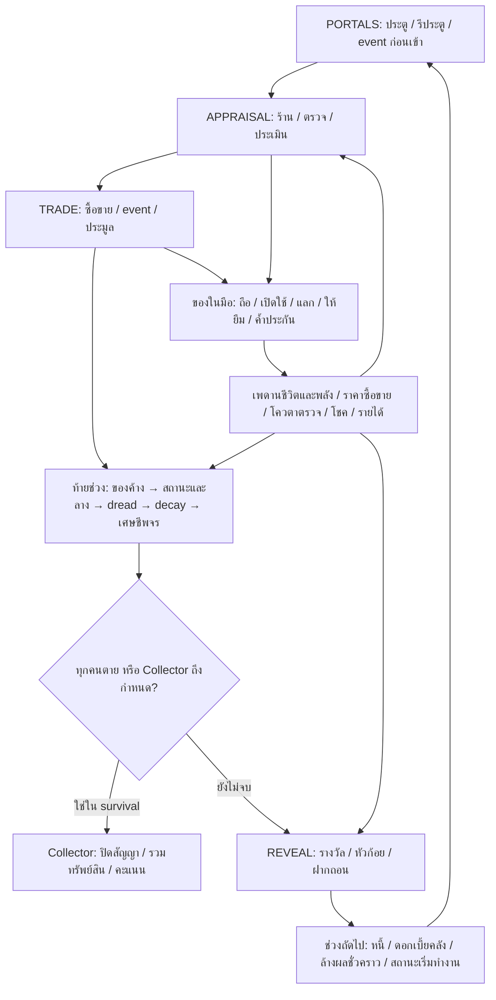

# รีวิวต่อ: วงจร encounter → event → ของใช้/ของถือ → ทรัพยากร → route

วันที่ 2026-10-23 · ฐานโค้ด `0f37012` · ต่อจาก [รีวิวรอบแรก](system-links-review-2026-10-23.md)

## ผลการตรวจ

**แก้ N1–N4 แล้ว:** timeout ตรวจทรัพยากรและเป้าหมายก่อนชำระ, event รักษาใช้เพดานจากของถือ, จ้างยามได้โดยไม่ต้องมีของสละ และค่า dread ที่ส่งให้ผู้เล่นใช้สูตรเดียวกับ settlement รายละเอียดการพบปัญหาด้านล่างเก็บเป็นหลักฐานก่อนแก้ ไม่ใช่สถานะปัจจุบัน

หลังผู้ใช้สั่งแก้ เพิ่ม runtime fix หลัง config `systemLinks: 1` ซึ่งเปิดโดยปริยายสำหรับเกมใหม่; audit เก่าที่ไม่มีค่านี้เก็บ eligibility/default เดิม ค่า view ของ dread แก้โดยตรงเพราะไม่เปลี่ยน state หรือคำสั่ง replay ข้อเสนอเพิ่ม route ด้านล่างยังเป็นแบบสำหรับพัฒนาต่อ ส่วน L1/L2 ของรีวิวเดิมถูกแก้แล้วหลัง `statusLinks: 1`

| ID | ระดับ | ผลที่พิสูจน์ได้ | จุดรับผิดชอบ |
| --- | --- | --- | --- |
| N1 | P1 สูง | ชำระเงินกู้ระหว่างมีค่าปรับค้าง → `done` และคำสั่ง timeout โยน `event-cost` | `events.ts:408–412`, `engine.ts:336–348`, `appraisal-rooms.ts:162–174` |
| N2 | P2 กลาง | ชีวิต 6/7 จาก life-relic แต่พลัง 0 → E126 ไม่เข้าเงื่อนไข ทั้งที่มีเงินซื้อยา | `core2-events.ts:49–52` |
| N3 | P2 กลาง | มีเงินจ้างยาม แต่ไม่มีของถือ หรือมี B06/B19 → E128 ไม่เกิด แม้ตัวเลือก `ward` จ่ายไหว | `core2-events.ts:55`, `core2-specs.ts:64` |
| N4 | P2 กลาง | B23 ลด dread จริง 8% → 4% แต่ `AppraisalView.dread` ยังเป็น 8% | `views.ts:50`, `core2-rules.ts:10` |

หลักฐาน: [โปรแกรมตรวจ](system-links-continuation-2026-10-23/audit.mjs), [ผลก่อนแก้](system-links-continuation-2026-10-23/report-before.json), [ผลหลังแก้พร้อม hash ของ source](system-links-continuation-2026-10-23/report.json)

### สิ่งที่เปลี่ยนและข้อพิสูจน์หลังแก้

- **N1:** default เลือกเฉพาะ choice ที่เคยเสนอและยังจ่ายไหว; เป้าหมายสินค้าต้องอยู่ใน offer เดิมและยังเป็นของผู้เล่น ถ้าไม่มีทางเหลือ ใช้โทษ `brand` ที่มีอยู่แล้วและบันทึก `event-default-fallback` ไม่ยึดของที่เพิ่งได้มาแทน และไม่ยกค่าปรับทิ้ง
- **N2:** eligibility ของ E126 และตัวเลือก heal ใช้ `maxLifeOf`/`maxEnergyOf` ที่สอดคล้องกับของในมือ
- **N3:** เงื่อนไข sacrifice กับ ward แยกกัน; กันตัวเลือกโล่ที่มีอยู่แล้วไม่ให้เสียเงินฟรี และไม่สร้าง event ที่เหลือแต่ decline
- **N4:** `AppraisalView.dread` เรียก `dreadNow(state,p)` จึงรวม B23 เฉพาะเจ้าของ view
- **เคสข้างเคียงจากการรัน gate:** classic ที่มี D10 อยู่แล้วไม่เสนอ `E03: debt` ซึ่งเดิมให้พลังพร้อมลด charges ของ D10 โดยไม่มีต้นทุนเพิ่ม; ยังจ่ายเครดิตซื้อพลังได้ตามเดิม ถ้าจ่ายไม่ไหวและไม่มีทางมีต้นทุนจะไม่เสนอ event นั้น ปิดหลัง `systemLinks: 1` เช่นกัน
- เพิ่ม [regression tests](../../tests/appraisal-system-links.test.ts) ครอบคลุมเงินเปลี่ยน, เป้าหมายหาย/ย้ายหลักประกัน, สินค้าใหม่ที่ไม่อยู่ใน offer, mandatory core2 events ทั้ง 8 ตัว, cap ของถือ, ward, dread และ **room service timeout**
- เก็บคำสั่ง/config และ audit SHA-256 ของ classic/survival ก่อนแก้ใน [legacy fixtures](../../tests/fixtures/system-links-legacy.json) แล้วตรวจ replay หลังแก้ได้ hash เดิมทั้ง 2 โหมด

## 1. ขอบเขตและกติกาที่ใช้ตรวจ

- ใช้ config เดียวกับ `src/server/appraisal-main.ts:9`: secureEconomy, brokerage, polish, npcEvents, core2 และค่าปริยายล่าสุด รวม rarityEconomy, itemEffects, statusLinks, eventChoiceRules, freeMerchantAction และ trustAbilities
- ตรวจทั้ง classic และ survival; survival ใช้ `SURVIVAL_RULES` ชีวิตตั้งต้น 6 พลังเข้า encounter 0
- ใช้ state จำลองเฉพาะเงื่อนไขขอบเขต แล้วเรียก logic จริง ไม่ใช่จำลองสูตรขึ้นใหม่ รายการเงินผ่าน `spend`/loan actions เพื่อให้ ledger ตรวจผ่าน
- รันทดสอบการเชื่อมบวก 3 กลุ่ม: คลัง ↔ ผลถือ, orb ↔ พลัง/การทำลายของ, เพดานถือ 5 ชิ้น ↔ โล่ B06 กัน D23
- สุ่มการเปิดตลาด 200 runs เฉพาะช่วงเริ่มเกม (100 seed ต่อโหมด) เพื่อเทียบ demand กับสินค้าทั้ง 3 ประตูของผู้เล่นทั้ง 2 คน ไม่ใช่ full-run bot simulation
- ตรวจ source ของวงจรซื้อขาย/สถานะ/เวลา/คะแนนเพิ่มจากรอบเดิม โดยไม่เปลี่ยนหลักที่ยืนยันแล้ว เช่น ผลถือของแท้/ปลอมเท่ากัน, สำเนา 40%, จบเกมไม่คืนชีพ และของถือสูงสุด 5 ชิ้นต่อชนิด

### วงจรที่ระบบทำอยู่



อ้างอิงลำดับจริง: `engine.ts:180–217,407–436` ใน classic หลัง REVEAL ของช่วงสุดท้ายจะปิดสัญญาและเข้า RESULTS; ใน survival ช่วงที่ Collector มาเข้า RESULTS ก่อนเปิดรางวัล REVEAL ของช่วงนั้น

## 2. สัญญาระหว่างระบบ: อะไรเชื่อมแล้ว อะไรยังขาด

| จุดเชื่อม | สิ่งที่ทำจริงและหลักฐาน | สถานะรอบนี้ |
| --- | --- | --- |
| ประตู → ร้าน → ของเพิ่มเติมจาก trust | `generatePortals` สุ่ม 3 NPC, `enter` เพิ่ม stock ตาม trust และใส่ rarity ให้ของในร้าน (`engine.ts:129–137,354–359`) | ต่อแล้ว; การเลือกประตูปกติยังไม่ได้ให้น้ำหนักตามประวัติ/ของถือ |
| ซื้อของ → สถานะ/ส่วนลด/ค่านายหน้า/ข้อมูล | `purchase` คิดผลถือก่อนรับสินค้า, ชำระเงินจริง, ถ่ายทอดข้อมูลและผลการประเมิน, ให้เงื่อนไขหลังโอน (`mechanics.ts:358–398`) | ต่อแล้วจาก source; ไม่อ้างว่าทุกชุดสถานะผ่าน exhaustive test |
| ถือของ → caps/ตรวจ/รายได้/โชค | `passiveBonuses` อ่านเฉพาะของที่อยู่ใน inventory และ owner ตรง, `heldPassives` เลือกแรงสุดไม่เกิน 5 ชิ้นต่อชนิด (`passives.ts:43–62`) | positive control ผ่าน |
| คลัง/หลักประกัน/ยืม Alien → ผลถือ | การเอาของออกจากมือทำให้ไม่ถูกนับใน passive; คลังกับ collateral ยังนับเป็น asset ตอนคิดคะแนน (`secure-storage.ts:46–49,227–229`, `npc-events.ts:123–157`) | ฝาก/ถอนพิสูจน์ด้วย engine; collateral/Alien อ่านโค้ด |
| เปิดใช้ → ความแท้/คำสาป/พลัง/ชีวิต/ของหมด | `activate` ตรวจของแท้หรือ seeded fake effect, ให้ drawback, ใช้ D14, ฟื้นทรัพยากร, ให้โบนัสใช้ชั่วคราว แล้ว retire ของ consumable (`mechanics.ts:399–460`) | orb positive control ผ่าน |
| ใช้ของผ่าน event → ผลเฉพาะ event | E07/E31–E40 มี logic แยกจาก activate และคิด scale ของของในหลายจุด (`events.ts:331–368`) | ต้องมี contract แยกชัด; อย่าเหมารวมว่าใช้กฎ activate ทั้งหมด |
| ของถือ → NPC bond | หมวด/ชนิด/ข้อมูลที่รู้เปิด event แบบ show/reveal/sell/swap/tribute (`brokerage.ts:27–110`) | ต่อแล้ว; rarity ใน applyGain ยังเป็นช่องว่าง L7 เดิม |
| event → เงิน/พลัง/ชีวิต/สถานะ | resolver จ่ายจริงและตรวจซ้ำ; grant เชื่อม B06, charges, power และ starts/expires (`mechanics.ts:83–141`) | resolver ตรวจซ้ำแล้ว แต่ default ของ core2 ยังมี N1 |
| ยา/พร → ชีวิตที่มีเพดานเพิ่ม | `healLife` ใช้ `maxLifeOf`; eligibility ของ E126 ใช้ค่าเริ่มต้น | เชื่อมไม่ครบ: N2 |
| ทรัพยากร → ทางเลือกจ้างยาม | ตาราง linked เพิ่ม `ward` ด้วยเครดิต แต่ eligibility ยังใช้เงื่อนไขพิธีสละของ | เชื่อมไม่ครบ: N3 |
| B23 → ความกดดันท้ายช่วง → view | `dreadNow` คิด B23 แต่ view เรียก `dreadChance` โดยตรง | logic ทำงาน แต่ข้อมูลข้าม boundary ผิด: N4 |
| ประมูล → ตั๋วคำสั่งมืด → บังคับซื้อ | `settleAuction` เพิ่ม darkTickets; `forceBuy` ตรวจ/ใช้ตั๋ว (`brokerage.ts:225`, `engine.ts:253–270`) | มี producer/consumer; รอบนี้ไม่ได้ทดสอบการใช้งานจริงครบเส้น |
| trade ข้ามคน → เศษชีพจร → ชีวิต | purchase ให้ shards เมื่อซื้อของที่คนอื่นประเมิน; `mendWithShards` ใช้เศษเฉพาะเมื่อยังมีชีวิตและไม่เต็ม (`mechanics.ts:160–173,393`) | ต่อแล้วจาก source; ห้ามสรุปจาก bot ที่ไม่แลกกัน |
| wish → ข้อมูล/ของ/เงิน/trust | ราคาเปลี่ยนตามอายุสัญญา, rarity/สำเนา/สถานะ, seeded accept/refuse, สำเร็จแล้ว retire และ trust +1 (`wishlist.ts:75–107`) | ต่อแล้ว; ยังขาด policy ที่เล่นเส้นนี้เพื่อวัด balance |
| ความสามารถพ่อค้า → cooldown → ไอเทมเวลา | ใช้ความสามารถอ่าน B25/D25, ไอเทมปรับ cooldown; B26 เพิ่มตัวเลือก Beast (`merchant-abilities.ts:81–120`, `mechanics.ts:409–421`) | ต่อแล้ว; candidate choice ต้องเก็บผลเดิมเมื่อ reconnect |
| rarity → ราคา/effect → คะแนน | `ensureItemAppearance` คูณ base/ask/reservation ครั้งเดียว; score อ่าน base ที่คูณแล้ว (`rarity.ts:10–19`, `scoring.ts:2–10`) | ต่อแล้ว; ห้ามคูณ rarity ซ้ำที่ Collector |
| จบเกม → สัญญาค้าง/คลัง/คะแนน | classic ปิดสัญญาที่ advance สุดท้าย; survival ปิดสัญญา/loan และรวม wallet+vault+asset ก่อน Collector (`engine.ts:412`, `survival.ts:14–34`) | ต่อแล้วจาก source; ไม่ใช่เงินที่ไหลกลับมาเปิดใช้ใน run ต่อ |

## 3. ข้อบกพร่องใหม่พร้อมวิธีทำซ้ำ

### N1 — ตัวเลือก default ของค่าปรับหมดอายุแล้ว แต่ยังถูกเลือกซ้ำ [P1]

**Trigger:** มี loan ค้าง และ E120 ถูกเสนอโดยมี `pay` เป็นตัวเลือกแรก ต่อมาชำระหนี้จนเครดิตต่ำกว่าราคาค่าปรับ

หลักฐานจากโปรแกรม:

1. กู้ 3 เครดิตโดยค้ำของมูลค่าซื้อขาย 6; E120 บันทึก `pay, energy, pouch`
2. เรียก `loan-repay` จริงระหว่าง offer ค้าง; engine ยอมรับ finance action ก่อนข้อจำกัด consequence
3. เครดิตเหลือ 0; ทางจ่ายพลังยังอยู่ใน offer เดิมและยังจ่ายไหว
4. ทั้ง `done` และ `defaultAppraisalAction → applyAppraisalAction` ล้มด้วย `event-cost`
5. การเลือก `energy` ด้วยมือก่อนหมดเวลายังสำเร็จ จึงไม่ใช่ state ที่ไม่มีทางชำระเลย

**สาเหตุ:** `defaultEvent` เลือก `offer.choices[0]` สำหรับ core2 consequence โดยไม่ตรวจต้นทุนปัจจุบัน ขณะที่ `resolveCore2Event` ตรวจต้นทุนปัจจุบันอย่างถูกต้อง

**ผลต่อห้อง:** `AppraisalRoomService.timeout` เรียกคำสั่งเดียวกันโดยไม่มี fallback และ message handler ประมวลผล timeout ก่อนรับ action เมื่อพ้น deadline (`appraisal-rooms.ts:63–66,162–174`) จึงมีเส้นทางให้ห้องค้างหลังหมดเวลา ข้อสรุปเรื่องห้องมาจาก call path; reproduction รอบนี้เรียก engine/default action โดยตรง ไม่ใช่ทดสอบ WebSocket

**แก้ที่ควรทำ:** default เลือกจากตัวเลือกใน offer ที่ยังถูกต้องและจ่ายไหว โดยมีลำดับผลเสียที่กำหนดไว้ หากไม่มีเลยต้องมี fallback ที่รับประกันว่า resolve ได้ อย่าแค่ดัก error แล้วเคลียร์โทษทิ้ง และอย่าสร้าง target ใหม่ที่ไม่เคยอยู่ใน offer โดยไม่มีการอัปเดตสัญญา offer

**เทสต์รับงาน:** หนี้ทำให้เครดิต/ของค้ำเปลี่ยนระหว่าง consequence, peer รับสัญญาทำให้เงินผู้ให้กู้ลด, เสีย target ให้ผู้เล่นอื่น และ default ของ E117–E124 ต้องจบได้โดย invariant ยังผ่าน

### N2 — ของเพิ่มเพดานชีวิตไม่เปิดเส้นทางรักษาส่วนที่เพิ่ม [P2]

**กรณีจริงจาก fixture:** ถือ life-relic → cap 7, life 6, energy 0, credits 40 แต่ E126 ไม่ eligible; เปลี่ยน life เป็น 5 จึง eligible

**สาเหตุ:** `core2EventEligible` เทียบกับ `state.config.survival.maxLife` (6) ส่วน `healLife` และ view ใช้ `maxLifeOf` (7) ทาง `calm` ที่ทำให้ E126 เข้าเงื่อนไขได้ต้องมีพลังอย่างน้อย 1 จึงบังบั๊กในกรณีทั่วไป

**ผล:** สายเพิ่มเพดานชีวิตที่พลังหมดเสียสิทธิ์ซื้อยาที่ควรมีผลกับช่องชีวิตว่าง ตัวอย่างนี้เปิด statusLinks ล่าสุด ซึ่งยาเป็นการเสี่ยง B24/D23 และ B24 ฟื้นตอนท้ายช่วง

**แก้ที่ควรทำ:** ให้ gate ของผลฟื้นทรัพยากรใช้ cap เดียวกับ resolver ทั้งชีวิตและพลัง ตรวจ `affordable` ของตัวเลือก `heal` ซึ่งยังใช้ค่าเริ่มต้นด้วย เพื่อไม่ให้กติกาเก่ากับกติกาใหม่แยกสูตร

### N3 — เพิ่มตัวเลือกจ้างยาม แต่ยังใช้ eligibility ของพิธีเก่า [P2]

`CORE2_CHOICES_LINKED.E128` มี `ward: credits 2 → B21` ซึ่งไม่ใช้ไอเทม แต่ `core2EventEligible` ยังกำหนด `inventory.length > 0 && !B06 && !B19` ทั้ง event

**ผลทำซ้ำ:** ตอนมือว่าง `core2EventChoices` คืน `ward, decline` แต่ `eventEligible` เป็น false; ใส่ mirror แล้วเป็น true; เพิ่ม B06 แล้วกลับเป็น false ทั้งที่ B06 กัน debuff และ B21 คุ้มกันการขโมยเป็นคนละผล

**แก้ที่ควรทำ:** แยกเงื่อนไขของ `offer` และ `ward`; ให้ event เกิดเมื่อมีอย่างน้อยหนึ่งทางที่มีความหมายและจ่ายไหว ตัวเลือกยามควรตรวจว่ามี B21 หรือยัง/ยอม refresh หรือไม่อย่างชัดเจน

### N4 — B23 เปลี่ยน logic แต่ข้อมูล dread ของผู้เล่นไม่เปลี่ยน [P2]

seed `links-continuation`, encounter 1: ก่อน B23 ทั้ง logic และ view = 0.08; หลัง B23 logic = 0.04 แต่ view = 0.08

**สาเหตุ:** `views.ts:50` ใช้ `dreadChance(encounter, omen)` แทน `dreadNow(state,p)`

**ผล:** consumer ของ `AppraisalView.dread` ได้ตัวเลขที่ไม่ตรงกับความเสี่ยงของเจ้าของ view ไม่มีข้อสรุปว่าหน้าจอปัจจุบันทุกจุดแสดง field นี้ เพราะรอบนี้ไม่ได้เปิด UI ตรวจ

**แก้ที่ควรทำ:** ใช้สูตรเดียวกันทั้ง resolver และ view; ทดสอบ B23 ร่วมกับลางและหลาย encounter รวมกรณีเพดาน chance

## 4. ช่องว่างของ route ที่ยังไม่ควรเรียกว่าบั๊ก

### G1 — ตลาด classic อ้างถึงของในช่วงอนาคต

`makeMarket` ใช้ชนิดจาก `Object.values(state.items)` ทั้งหมด (`engine.ts:160`) แต่ classic สร้าง schedule ทุกช่วงล่วงหน้า ส่วน survival สร้างทีละช่วง

ผลสุ่มด้วย seed ชุดเดียวกัน, 2 คน, marketProbability=1:

| โหมด | runs | ตลาดเปิด | คำสั่งซื้อ | ไม่มีในสินค้าเริ่มต้นทั้ง 6 ประตู | runs ที่มีคำสั่งแบบนี้ |
| --- | ---: | ---: | ---: | ---: | ---: |
| classic | 100 | 100 | 198 | 112 (56.6%) | 75 |
| survival | 100 | 100 | 200 | 0 | 0 |

นี่ไม่ใช่หลักฐานว่า "หาของไม่ได้แน่นอน" เพราะรีประตู/ของเพิ่มจาก trust/ของจาก ability/event อาจสร้างชนิดนั้นได้ และการทดลองจำกัด encounter 1 แต่เป็นหลักฐานว่า seed และโหมดมีความต่างจากวิธีเก็บ schedule ซึ่งไม่ได้สะท้อนสภาพตลาดปัจจุบัน

**ข้อเสนอ:** สัดส่วน demand จากของที่เข้าถึงได้ตอนนี้ + ของในมือ + rare speculative demand ที่บอกใบ้ให้ผู้เล่นตั้งใจเสี่ยง เส้น speculative ควรมีรางวัลมากขึ้นหรือหมดอายุช้ากว่า ไม่ควรพึ่ง state อนาคตโดยบังเอิญ

### G2 — event หลายชุดแข่งขันกันด้วยลำดับตายตัว

ใน APPRAISAL ลำดับคือ personal NPC → bond → wish → expansion → polish → ปกติ (`engine.ts:209–213`) และมี offer slot 2 ต่อ encounter การได้ event ต้นช่วงกับ personal ใช้ครบแล้วอาจทำให้ route ท้ายช่วงไม่ถูกเสนอ แม้เพิ่งได้ไอเทมที่เหมาะกับมัน

ระบบพยายามเลือก event ที่ยังไม่เคยเห็นภายในแต่ละ pool แล้ว แต่ไม่ได้ถ่วงน้ำหนักความหลากหลายข้าม pool และปกติไม่มีการจับ event ใหม่ทันทีเมื่อเพิ่งซื้อไอเทม ควรวัดจำนวนครั้งที่ eligible แต่ถูก priority/slot บัง แยกจากจำนวนครั้งที่ offered

### G3 — คำว่า “ใช้ไอเทม” ครอบคลุมหลายสัญญา

activate, bond, sacrifice, cleanse และ merchant ability อ่านของชิ้นเดียวกัน แต่ไม่ควรเรียก activate ซ้ำให้ทุก action เพราะบาง action คือขาย/แสดง/เผาของ ส่วนบาง action คือเปิดใช้ ควรประกาศข้อมูลต่อ effect ให้ชัด: ต้องแท้ไหม, curse ทำงานไหม, ใช้ power ใด, มี costs อะไร, consumed ไหม, ใช้ activation slot ไหม, B06/B07 กันอะไรได้

L3 เดิม (ผลถือไม่สนแท้/คำสาป) เป็นกติกาที่ประกาศใน UI แล้ว จึงไม่เสนอให้เปลี่ยนอัตโนมัติ ควรเพิ่มเหตุผลในการตรวจ/ล้างคำสาปผ่าน event และราคาขายตามของจริงก่อน

### G4 — เคสปลาย run กับผล “ช่วงหน้า” ยังรอการตัดสิน

L4 เดิมยังอยู่: `grant` ข้าม B09/D04/D07 ใน classic ช่วงสุดท้าย อย่าเพิ่ม event สัญญาช่วงหน้าโดยไม่ดู horizon และต้องแยก classic จบที่ REVEAL กับ survival จบก่อน REVEAL ตอน Collector มา ควรระบุว่าผลที่หมดเวลากลายเป็นอะไรหรือไม่เสนอเลย

## 5. แบบเพิ่ม seed และ route ที่เชื่อมกับของเดิม

เป้าหมายคือ **seed ทำให้โอกาสและต้นทุนต่างกัน แล้วการตัดสินใจเปลี่ยนผลต่อเนื่อง** การเปลี่ยนเพียงชื่อหรือเพิ่ม roll ไม่มีผลเชิงกลไกยังไม่เพิ่ม route ที่มีความหมาย

| Route ที่เสนอ | เงื่อนไข / การตัดสินใจ | ทรัพยากรและระบบที่รับผล | จุดเสี่ยง/ทางออก |
| --- | --- | --- | --- |
| ผู้คุ้มกันคาราวาน | เปิด `ward` ให้จ่ายเครดิตโดยไม่บังคับถือของ; ลางโจรเพิ่มน้ำหนักข้อเสนอยาม | เครดิต → B21 → ผลเสมอใน RPS / ความเสี่ยงราคาพอง | จ่ายยามแล้วซื้อของได้น้อยลง; คนไม่มีเงินเลือกถือของมูลค่าต่ำ/เก็บคลังได้ |
| หมอเถื่อนกับศิลาชีพจร | cap ของจริงเปิด E126; เลือก B23 ด้วยพลัง หรือยา seeded B24/D23 ด้วยเครดิต | maxLife → ทางฟื้น → ความอยู่รอด; B06 หรือความสามารถ Dark One ช่วยจัดการผลเสีย | มีโอกาสเลือดไหล; ไม่เพิ่มสถานะหรือเงินใหม่ |
| นายหน้าข่าวสาร | ของสายตรวจเปิด reveal bond; ข้อมูลใช้ประเมิน/เปิดขายข้ามร้าน/ขายข่าว | พลังและโควตาตรวจ → knowledge → ค่านายหน้า/เครดิต → trust และ stock เพิ่ม | เสียเวลาตรวจแทนการเสี่ยงราคา; จ่ายซ้ำไม่ได้เมื่อข้อมูลเผยแล้ว |
| นักล่าคำขอ | demand เลือกจากของที่หาได้พร้อมคำใบ้ NPC; wish ที่ลดราคาตามเวลาทำให้เลือกกลับไปหาพ่อค้า | ประตู/รีประตู → ของในมือ → wish/ตลาด → เงินและ trust | เสียพลังรีประตู; ขายตลาดทันทีหรือรอ wish ต้องคุ้มต่างกัน |
| นักสะสมให้ยืม | บาง seed เพิ่มน้ำหนัก Alien/bond ที่อ่านหมวดของที่ถือ โดยเลือกโอกาสก่อนสร้าง offer | ของในมือ → สัญญายืม → เสีย passive ระหว่างรอ → ได้ของคืน/ผลตอบแทน | ต้องชัดว่าของในสัญญาไม่ให้ผลถือ; คืนของเดิมเมื่อ run จบตามกติกา |
| สายทุนหมุนเวียน | ราคาของที่ซื้อจริงเปิด collateral; เก็บรายได้เข้าคลังหรือชำระหนี้ก่อนกำหนด | appraisal/provenance → lastTradePrice → loan → สภาพคล่อง → ซื้อ/รักษา | ทุนที่เก็บไม่ช่วยจ่ายค่าปรับในกระเป๋า; แก้ N1 ก่อนส่งเสริมเส้นนี้ |
| ผู้ชนะประมูล | ลาง/ประวัติช่วงก่อนเพิ่มน้ำหนักของใน auction ที่สัมพันธ์กับ wish โดยไม่ล็อกผลแพ้ชนะ | ของค้าง → auction → ตั๋ว → force-buy → ได้ของและเกิดค่านายหน้าของผู้ประเมิน | ต้องจ่ายเงินจริงและแข่งขัน; ห้ามแจกตั๋วเพิ่มโดยไม่ตรวจอัตราสะสม |
| จังหวะพ่อค้า | event เวลาเชื่อม NPC ที่ไว้ใจแล้วและ cooldown ที่ยังลดได้; B26 ช่วยคัดสินค้าตอบ demand | trust → ability → cooldown → ของเวลา/พลัง → ตัวเลือกสินค้า | ลงทุนสกิลตอนนี้แลก cooldown ถัดไป; ห้าม reroll candidate เดิมด้วย reconnect |

ข้อเสนอเพิ่มที่ใช้งานร่วมกันได้:

1. **น้ำหนักตามสภาพจริง:** ลาง + ประวัติ event + สิ่งที่ถือ + trust + ทรัพยากร + จำนวนช่วงที่เหลือ ให้โบนัสน้ำหนักโดยไม่รับประกันของที่ผู้เล่นต้องการทุกครั้ง และมี pool พื้นฐานที่จ่ายไหวเสมอ
2. **ผลต่อเนื่องช่วงหน้า:** เลือกต้นเรื่องจาก seed เช่น พายุเปิดโอกาสซ่อม/ฟื้นช่วงหน้า แต่ให้การเลือกของผู้เล่นเป็นตัวกำหนดปลายทาง เก็บสถานะการตัดสินใจไว้ใน run ห้ามอนุมานจากข้อความใน notes
3. **แยก namespace RNG:** เช่น `encounter:player:route-v2:pick`, `...:offerId:outcome` เพื่อให้เพิ่มเนื้อหาหนึ่งชุดโดยไม่ทำให้ผลสุ่มที่ไม่เกี่ยวกันเลื่อนตาม array
4. **เวอร์ชันกติกา:** เพิ่ม config เช่น `systemRoutes: 1` สำหรับน้ำหนัก/ผลแบบใหม่; audit เก่าที่ไม่มี flag ต้อง restore/replay เดิม อย่าเพิ่มค่าใหม่เข้า config เก่าโดยเงียบ ๆ

## 6. ลำดับแก้และเกณฑ์จบงาน

1. แก้ N1 ก่อน: resolver/default/timeout ต้องเลือกทางที่ legal และไม่ปล่อยให้ phase ค้างเมื่อทรัพยากรเปลี่ยน
2. แก้ N2/N3/N4: eligibility, choices, view และผลจริงใช้ contract เดียวกัน แล้วเพิ่มเทสต์เชิงพฤติกรรมเป็น regression แทนการ assert ว่าบั๊กยังอยู่
3. ทำ demand provenance และตัวนับ eligible/offered/resolved/blocked-by-slot แยกตาม pool เพื่อวัด G1/G2
4. เพิ่ม route 2 เส้นแรกที่ใช้ของเดิม เช่น คาราวาน + หมอเถื่อน แล้ววัดก่อนขยายทุกเส้น
5. เติม policy ที่ใช้ wish, cleanse, ตลาด, คลัง, เงินกู้, RPS และแลกข้ามคน; simulation เก่าที่ไม่เลือก action เหล่านี้ใช้ยืนยัน balance ของมันไม่ได้

### เงื่อนไขรับงานข้ามระบบ

- ผลทุกตัวมี producer → gate → target → cost → mutation → expiry → view → settlement ที่ตามได้; การมีชื่ออยู่ในตารางไม่เท่ากับเข้าถึงได้
- ทุก choice ที่แสดงต้อง legal กับเป้าหมายปัจจุบัน; default ต้องจบได้หลังเงิน/ของ/สถานะเปลี่ยน โดยไม่ยกเว้นค่าปรับฟรี
- ย้ายของแต่ละแบบต้องทำให้ passive/caps/ข้อมูล/สัญญา/คะแนนสอดคล้องกันทันที และไม่ให้สำเนารับผลเต็มผ่านทางรอง
- จบช่วงต้องทดสอบก่อน/หลัง expiring status, ก่อน/หลัง Collector, ชีวิต 1, พลัง 0, เงิน 0, ของล็อก, สินค้าหาย, bank reserve ต่ำ และสองผู้เล่นแย่ง target เดียวกัน
- seed เดิม + config เดิม + commands เดิมให้ผลเดิม; reconnect ไม่เปลี่ยน offer/candidate; config รุ่นเก่ายัง replay ได้
- เพิ่ม route ต้องเพิ่มทางเลือกที่มีข้อแลกเปลี่ยน และตรวจว่าไม่กลายเป็นตัวเลือกฟรี/ทางเลือกที่ด้อยกว่าอีกทางทุกกรณี

## 7. การรันและข้อจำกัดหลักฐาน

```sh
npm run build:server
node docs/validation/system-links-continuation-2026-10-23/audit.mjs --expect-fixed
node --test dist/tests/appraisal-system-links.test.js
node --test dist/tests/appraisal-status-links.test.js dist/tests/appraisal-item-effects.test.js dist/tests/appraisal-secure-storage.test.js dist/tests/appraisal-secure-integration.test.js dist/tests/appraisal-core2.test.js dist/tests/appraisal-brokerage.test.js
```

`audit.mjs` เป็น diagnostic: `reproduced: true` หมายถึงยังพบบั๊ก; `fixed: true` หมายถึงผลตรงพฤติกรรมที่แก้แล้ว และ `--expect-fixed` จะ fail ถ้าแก้ไม่ครบ ผล JSON มี SHA-256 ของ source ที่ใช้ตรวจ; ควร build ใหม่ก่อนรันทุกครั้ง

ผลตรวจรอบนี้: build server ผ่าน, diagnostic ทำซ้ำ N1–N4 ครบ, positive controls ผ่าน 3 กลุ่ม, ตัวอย่างตลาดครบ 200 runs และเทสต์เดิม 6 ไฟล์ผ่าน **97/97** (ประมาณ 48 วินาที) เทสต์เดิมที่ผ่านยังไม่ครอบคลุมข้อบกพร่องใหม่เหล่านี้

**ผลหลังแก้:** server build และ appraisal client typecheck ผ่าน; regression ใหม่ **13/13**; gate ที่เกี่ยวข้อง 11 ไฟล์ **140/140** (ประมาณ 51 วินาที รวม regression ใหม่); `audit.mjs --expect-fixed` ยืนยัน N1–N4 เป็น `fixed: true` ทั้งหมด หลักฐาน: [verification.json](system-links-continuation-2026-10-23/verification.json), [test output](system-links-continuation-2026-10-23/tests-after.txt)

รอบนี้ไม่ได้เปิด browser, ไม่ได้พิสูจน์ทุก event × ทุก item × ทุกสถานะ × ทุกโหมด และไม่ได้วัด balance ทั้ง run ตัวเลขตลาดเป็น seed sample ที่กำหนดไว้และไม่มี reroll ในตัวอย่าง การทดสอบ room service เป็น protocol/clock integration ใน process ไม่ใช่ WebSocket จริง

`trail check` แบบทั้ง branch ไม่ผ่าน: เครื่องมือตรวจ 50 ไฟล์จาก diff ของ branch ตัดข้อมูลที่ 400 KB และแจ้ง 20 conflicts ในไฟล์เดิม `.impeccable/*` กับ `event-choice-review-2026-10-23.md` ไม่มีรายการ conflict จาก audit ใหม่ในผลนั้น ไฟล์เหล่านั้นไม่ได้ถูกแก้ในงานรีวิวนี้ จึงยังถือว่า branch gate ไม่เขียวและไม่ได้ commit/push

หลังแก้รัน `trail check --base HEAD --json` เพื่อตรวจ diff ปัจจุบัน: ยัง exit 1 จาก 18 รายการใน `.impeccable/*` ที่มีอยู่ก่อนงานนี้ และ 2 รายการที่ import บรรทัด 3 ของ `core2-events.ts` ตรงคำจาก learning เก่า การเพิ่ม `maxLifeOf`/`maxEnergyOf` ใน import ไม่ได้เปลี่ยนโอกาสขโมย ราคาพลัง เวลาฝากถอน หรือสิทธิ์ออกแบบไอเทม จึงเป็น keyword matches ที่ไม่ขัดกับเจตนาของ learning นั้น ยังคงรายงานว่า gate ไม่เขียว และไม่ได้ commit/push; ได้ refresh graph ด้วย `trail build` แล้ว
